# MOVE — Manual de usuario

Plataforma de **Performance, Rehab y Recovery** de MOVE (Uruguay): registro, planes, pagos, reservas, asistencia, seguimiento y renovación en un solo lugar.

Este manual es la guía única para clientes, staff de MOVE y equipo técnico. Tiene una captura de cada pantalla y se ordena así:

1. [Probar MOVE en local](#probar-move-en-local): los pasos, en orden, para tener la plataforma funcionando en tu computadora con datos de demostración, y qué muestra cada usuario de demo.
2. [Estado actual frente a MOVE.pdf](#estado-actual-frente-a-movepdf): qué está hecho, qué está simulado en local y qué falta, sección por sección del documento de alcance. Termina con la [deuda conocida](#deuda-conocida-y-comportamientos-a-tener-presentes) y con [qué queda abierto al cerrar la tanda de deuda](#qué-queda-abierto-al-cerrar-la-tanda-de-deuda): decisiones pendientes, falta de deploy y deuda menor de tests y herramientas.
3. [Parte 1: Clientes](#parte-1-clientes): cómo usar el sitio, contratar un plan y reservar.
4. [Parte 2: Staff de MOVE](#parte-2-staff-de-move): el panel de gestión (clientes, turnos, pagos, seguimiento y configuración).
5. [Parte 3: Cómo levantar todo](#parte-3-cómo-levantar-todo): el sistema completo en una computadora, paso a paso, y el orden para publicarlo en producción.
6. [Parte 4: Proveedores, uno por uno](#parte-4-proveedores-uno-por-uno): qué falta configurar en Neon, AWS, Vercel, el dominio, Mercado Pago, Google, Brevo y Bitbucket, con los links a la documentación oficial.
7. [Parte 5: Puesta en marcha y mantenimiento](#parte-5-puesta-en-marcha-y-mantenimiento): primer usuario de staff, checklist posterior al deploy, rollback y cómo regenerar este manual.

> **Sobre los datos de las capturas.** Todas las imágenes salen de una base de demostración con personas, emails y teléfonos **inventados** (emails `@example.com`), cargada el 13/10/2026. Los planes, precios, horarios y umbrales que se ven son **provisorios** hasta que MOVE los confirme (ver [Reglas y valores provisorios](#reglas-y-valores-provisorios)). Hoy no hay una versión publicada: todo corre localmente (ver la [Parte 3](#parte-3-cómo-levantar-todo)).

## Probar MOVE en local

Esta sección es el camino más corto para ver la plataforma funcionando en tu computadora, con clientes, reservas, pagos y alertas de demostración. No hace falta ninguna cuenta de proveedor: Mercado Pago se reemplaza por un **simulador de pagos**, los emails de Brevo **no salen** (quedan registrados en la base) y el botón de Google queda oculto. Todos los datos son inventados.

**Antes de empezar.** Node 24 (`nvm use` lee `.nvmrc`), pnpm 10 (`corepack enable`) y Docker abierto. Los puertos **3000** (web), **3001** (API) y **5432** (Postgres) tienen que estar libres. Los comandos se corren desde la raíz del repositorio. Vas a usar **tres consolas**: una para los pasos 1 a 7 y la API, otra para cargar los datos de demostración (paso 8) y otra para la web (paso 9).

1. **Instalar las dependencias.**

   ```bash
   pnpm install
   ```

2. **Variables de entorno.** La API valida sus variables al arrancar y no arranca si falta una obligatoria. Los ejemplos traen valores de desarrollo listos para usar:

   ```bash
   cp apps/api/.env.example apps/api/.env
   cp apps/web/.env.example apps/web/.env.local
   ```

   Si preferís no crear archivos, exportá las variables así. **El ejemplo de la API va solo en las consolas de la API (pasos 3 a 7) y en la de `manual:demo-data` (paso 8)**; incluye `NODE_ENV=development`, que la API exige:

   ```bash
   set -a; . apps/api/.env.example; set +a
   ```

   **En la consola de la web (paso 9) no cargues ese archivo**: trae `PORT=3001`, y la web toma su puerto de `PORT`, así que intentaría usar el 3001 (el de la API) y fallaría con `EADDRINUSE`. Ahí exportá solamente la URL de la API:

   ```bash
   export NEXT_PUBLIC_API_URL=http://localhost:3001/api
   ```

   Si reutilizás una consola donde ya cargaste el ejemplo, corré antes `unset PORT` o levantá la web con `pnpm dev:web -p 3000`.

3. **Postgres.** Levanta Postgres 17 en Docker (contenedor `move-postgres`, base `move`, usuario y clave de desarrollo `move`) y espera a que figure como `healthy` en `docker ps` (unos segundos). Corrélo con los valores del ejemplo (base `move`): si tenés `DB_NAME` exportado con otro nombre, Docker recrearía el contenedor con esa base.

   ```bash
   pnpm db:up
   ```

4. **Esquema de la base.** Crea las tablas. Si ya tenías una base de una versión anterior, **el mismo comando aplica las migraciones nuevas** (por ejemplo, la que permite reutilizar el identificador de un plan eliminado): corrélo siempre después de actualizar el código.

   ```bash
   pnpm --filter @move/api migration:run
   ```

5. **Datos iniciales.** Planes, horarios y configuración provisorios (es idempotente: repetirlo no duplica nada). La primera vez imprime `Seed inserted plans=7 professionals=1 templates=100`.

   ```bash
   pnpm --filter @move/api seed
   ```

6. **Usuario de staff.** Usá el email `staff@example.com`: es el que esperan los scripts de demostración. La contraseña (8 caracteres o más) se escribe sin eco y **no se guarda en ningún archivo**; anotala, la vas a necesitar de nuevo en el paso 8.

   ```bash
   printf 'Contraseña del staff: '; read -rs CREATE_STAFF_PASSWORD && export CREATE_STAFF_PASSWORD; echo
   pnpm --filter @move/api user:create-staff -- --email staff@example.com --name "Equipo MOVE"
   unset CREATE_STAFF_PASSWORD
   ```

   El comando imprime solo el id (`staff <id>`).

7. **Levantar la API** (esta consola queda ocupada por la API). Al arrancar genera los turnos de los próximos días:

   ```bash
   pnpm dev:api
   ```

   En otra consola, `curl http://localhost:3001/api/health` tiene que responder `{"status":"ok"}`.

8. **Cargar los datos de demostración** (consola 2, con la API del paso 7 corriendo). La contraseña del staff es **la misma** del paso 6; la de los clientes es una nueva, de 8 caracteres o más, común a todos los clientes de demo. Ninguna se imprime ni se escribe en un archivo:

   ```bash
   printf 'Contraseña del staff: '; read -rs MANUAL_STAFF_PASSWORD && export MANUAL_STAFF_PASSWORD; echo
   printf 'Contraseña de los clientes: '; read -rs MANUAL_CLIENT_PASSWORD && export MANUAL_CLIENT_PASSWORD; echo
   pnpm manual:demo-data
   ```

   El script comprueba que Docker y la base responden, imprime la **base destino** antes de escribir (`Base destino: move …`) y se **niega a cargar** datos si `DB_HOST` o `API_URL` no son locales (localhost, 127.0.0.1 o ::1). Tarda unos segundos. Solo se puede cargar **una vez por base**: si ya hay datos de demostración, avisa y no hace nada (para repetirlo, usá una base nueva: ver [Regenerar este manual](#regenerar-este-manual)). Las fechas son relativas al día de la carga (planes que vencen en unos días, asistencias de las últimas semanas, turnos de hoy).

9. **Levantar la web** (consola 3, **sin** `PORT` exportado: ver el paso 2) y abrir `http://localhost:3000/ingresar`:

   ```bash
   pnpm dev:web
   ```

   Ingresá con `staff@example.com` y la contraseña del paso 6 para ver el panel de staff, o con cualquier cliente de la tabla de abajo y la contraseña del paso 8 (`MANUAL_CLIENT_PASSWORD`).

**Usuarios de demostración.** Todos los clientes usan la misma contraseña (`MANUAL_CLIENT_PASSWORD`) y el staff la que se eligió en el paso 6. **Nunca hay contraseñas guardadas en el repositorio ni en este manual**: son las que vos elegís y exportás en tu consola.

| Usuario (`@example.com`) | Qué muestra |
|---|---|
| `staff` | Todo el panel de staff: dashboard, clientes, turnos y asistencia, pagos, seguimiento, check-ins y configuración |
| `sofia.martinez` | La clienta "al día": Plan Trimestral vigente (vence en 55 días) y un paquete Recovery de 4 sesiones con una sesión reservada. Asiste casi todos los días (con una ausencia y un no show en su historia), tiene reservas próximas y respondió el check-in |
| `martin.rodriguez` | Plan Mensual vigente (vence en 12 días), reservas próximas, una reserva cancelada y el check-in respondido |
| `lucia.pereira` | Plan Mensual **por vencer** (vence en 4 días): alerta "Por vencer", aviso de vencimiento en su perfil, una asistencia **pendiente de marcar** en el último turno y un check-in pendiente de responder |
| `andres.silva` | Plan Mensual **vencido** (venció hace 5 días): alerta "Vencidos sin renovar"; no puede reservar y su perfil lo lleva a renovar |
| `camila.fernandez` | Plan Trimestral vigente pero **inactiva** (casi 4 semanas sin asistir): alerta "Inactividad prolongada" con un contacto de WhatsApp registrado sin respuesta; tiene un check-in pendiente |
| `joaquin.techera` | Plan Mensual con **pausa por lesión** y fecha de re-contacto hoy: estado "Pausa" y alerta "Re-contactar"; no recibe alertas ni emails automáticos |
| `valentina.gomez` | Plan Trimestral pagado por **transferencia** (pago manual). Pasó más de una semana sin asistir: el staff la contactó y la alerta figura como gestionada. Tiene el check-in pendiente (es la que se ve en la pantalla de check-in) |
| `federico.alvarez` | Respondió el check-in con una **molestia**: el staff lo derivó a Rehab, tiene el **seguimiento fisioterapéutico habilitado** y un turno de Rehab reservado (Reservar → Fisioterapia) |
| `diego.machado` | Plan Mensual pagado en **efectivo** (pago manual). Alerta de **baja de frecuencia**, un no show en el último turno y un check-in con **cambio de objetivos** (alerta abierta) |
| `nicolas.acosta` | Sin plan ni compras: sirve para contratar un **paquete Recovery** de punta a punta (checkout → simulador de pagos → resultado) |
| `paula.rivero` | **Invitada**: compró la Evaluación de Rehab sin tener cuenta |
| `mateo.lemos` | **Invitado**: compró una sesión individual de Recovery sin tener cuenta |

Las cuentas de los invitados (`paula.rivero` y `mateo.lemos`) **no pueden ingresar** en local: su acceso se define con el link de un email de invitación y, en dry-run, el email no sale ni guarda el link (ver el paso 7 de [Local, paso a paso](#local-paso-a-paso)). Sirven para ver sus compras en **Pagos** y sus turnos en **Turnos y asistencia**.

**Para volver a empezar** con una base limpia sin tocar otras: `docker exec move-postgres createdb -U move move_demo`, exportar `DB_NAME=move_demo` en las consolas de la API y de los scripts, y repetir desde el paso 4. **No corras `pnpm db:up` ni `pnpm db:down` con `DB_NAME` exportado distinto de `move`**: Docker recrearía el contenedor de Postgres con esa base. Para frenar todo: `Ctrl+C` en las consolas de la API y de la web, y `pnpm db:down` para apagar Postgres (los datos quedan en el volumen de Docker).

**Si algo falla:**

- **La API no arranca y el log dice qué variable falta o es inválida:** el paso 2 no se hizo en esa consola, o se editó un valor. `PORT` y `DB_PORT` aceptan solo dígitos (1 a 65535) y `DB_SSL` solo `true` o `false`.
- **`manual:demo-data` dice que no puede conectar a la base:** Docker no está abierto o el contenedor `move-postgres` no está levantado (paso 3).
- **`manual:demo-data` dice "Ya hay datos de demostración":** la base ya se cargó; usá una base nueva (ver arriba).
- **El puerto 3000 o 3001 está ocupado:** cerrá la otra aplicación o cambiá `PORT` (API) y el puerto de la web, y mantené `WEB_URL`, `API_PUBLIC_URL` y `NEXT_PUBLIC_API_URL` apuntando a esos puertos.

## Estado actual frente a MOVE.pdf

`MOVE.pdf` es el documento de alcance del MVP. Las tablas siguen sus secciones, en el mismo orden. Estados:

- **Hecho**: implementado y probado en local (tests automáticos y la pantalla indicada).
- **Simulado en local**: el código está completo, pero hoy funciona contra un reemplazo de desarrollo porque faltan las credenciales del proveedor.
- **Pendiente**: no se hizo en este proyecto; los pasos están en este manual.

**Resumen.** Toda la funcionalidad de clientes y staff está hecha y corre en local. Nada está publicado: no hay ambientes de desarrollo ni de producción en la nube, y Mercado Pago, Brevo y Google no tienen credenciales cargadas. Lo que falta para salir a producción es configuración de proveedores y deploy ([Parte 3](#producción-en-orden) y [Parte 4](#parte-4-proveedores-uno-por-uno)), más la confirmación de los valores provisorios por parte de MOVE.

### Perfiles de usuario y sitio público

| Requisito | Estado | Evidencia |
|---|---|---|
| Perfiles Visitante, Cliente/Alumno y Staff MOVE | Hecho | Roles `client` y `staff`; el visitante navega sin cuenta. La API responde 401 sin sesión y 403 a un cliente en `/api/staff/*`; la web redirige según el rol |
| Inicio, Performance, Rehab, Recovery y Planes | Hecho | Capturas 01–09 |
| Acceso al perfil, registro e inicio de sesión | Hecho | Capturas 12, 13 y 17 |
| Contratar o reservar sin ser cliente, creando el usuario en el proceso | Hecho | Rehab y sesión individual de Recovery admiten invitados (capturas 05 y 07). Contratar un plan o paquete pide ingresar primero |
| Uso desde el celular (agregado) | Hecho | Menú ☰ en el sitio público, el perfil del cliente y el panel de staff; las tablas de Turnos y asistencia y de Pagos se muestran como tarjetas (ver [Sitio público](#sitio-público), [Turnos y asistencia](#turnos-y-asistencia) y [Pagos](#pagos)); la suite de pruebas end to end recorre las pantallas en escritorio y en celular |

### Performance, reservas y asistencia

| Requisito | Estado | Evidencia |
|---|---|---|
| Planes con reserva previa, sin límite semanal | Hecho | Captura 02; un plan vigente permite reservar cualquier turno con cupo |
| Capacidad máxima por horario | Hecho | Captura 03 (`5 / 14 cupos`); dos clientes por el último cupo: se confirma uno solo (`SLOT_FULL` al otro) |
| Consultar plan y vencimiento, renovar, ver horarios, reservar, cancelar, próximas reservas e historial | Hecho | Capturas 17, 18 y 22–24; cancelar hasta 2 h antes (configurable) |
| Plan vencido bloquea nuevas reservas y lleva a renovar | Hecho | Error `PLAN_REQUIRED` y aviso "Tu plan venció" con link a Planes |
| Reserva vs. asistencia efectiva: presente, ausente y no show | Hecho | Captura 29; última asistencia, frecuencia, cancelaciones y no shows en el detalle del cliente (captura 28) |

### Rehab

| Requisito | Estado | Evidencia |
|---|---|---|
| Evaluación → fecha y horario → pago → reserva confirmada → confirmación al cliente | Hecho (pago simulado en local) | Capturas 04, 05, 23 y 24; email `booking-confirmed` (en dry-run en local) |
| Abierta a alumnos y externos; se vincula al perfil o crea un usuario | Hecho | Checkout de invitado; si el email ya tiene cuenta pide ingresar (`LOGIN_REQUIRED`) |
| Tratamientos posteriores no se venden online | Hecho | Solo la evaluación tiene precio en la web |
| Seguimiento fisioterapéutico definido individualmente | Hecho | El staff lo habilita por cliente (captura 28); el cliente reserva desde su perfil (capturas 19 y 20), sin cobro online |

### Recovery

| Requisito | Estado | Evidencia |
|---|---|---|
| Abierto a clientes y público general; sesiones individuales y paquetes mensuales | Hecho | Capturas 06, 07 y 09; paquetes de 4 y 8 sesiones válidos 30 días |
| Selección de sesión o plan → reserva → pago → confirmación | Hecho (pago simulado en local) | Capturas 07, 22–24 |
| La operación queda asociada al perfil o crea un usuario | Hecho | Igual que Rehab |

### Perfil del cliente

| Requisito | Estado | Evidencia |
|---|---|---|
| Plan activo y vencimiento; comprar o renovar | Hecho | Captura 17; renovar antes de vencer extiende desde el vencimiento |
| Reservar Performance, Recovery y Fisioterapia; próximas reservas | Hecho | Capturas 11, 17, 19 y 20 |
| Historial de actividad | Hecho | Captura 18 |
| Avisos y comunicaciones de seguimiento | Hecho | Bloque Avisos y campana (captura 17); check-in mensual (captura 21) |

### Panel de gestión MOVE

| Requisito | Estado | Evidencia |
|---|---|---|
| Estado, plan, inicio y vencimiento, pagos y renovaciones, última asistencia, frecuencia, reservas y cancelaciones, uso de Rehab y Recovery, historial de contactos | Hecho | Capturas 26 y 28 |
| Personas registradas en cada turno y marcado ágil de asistencia | Hecho | Captura 29 |
| Pagos (agregado en el proyecto) | Hecho | Capturas 30 y 31: operaciones de Mercado Pago y pagos manuales en efectivo o transferencia |
| Configuración de planes, horarios, profesionales y reglas (agregado) | Hecho | Capturas 35–38 |

### Seguimiento y retención

| Requisito | Estado | Evidencia |
|---|---|---|
| Plan por vencer, vencido sin renovar, una semana sin asistir, inactividad prolongada, baja de frecuencia, re-contacto en fecha | Hecho | Captura 32; detección diaria (07:00) y botón **Ejecutar detección ahora**; umbrales provisorios en Configuración |
| Motivos de inactividad (lesión, vacaciones, pausa temporal, falta de tiempo, mudanza, volver más adelante) | Hecho | Captura 28; el cliente en pausa no recibe alertas ni emails automáticos salvo el re-contacto |
| Registro de contactos | Hecho | Captura 33 |

### Check-in de clientes

| Requisito | Estado | Evidencia |
|---|---|---|
| Consultas breves a alumnos activos (evolución, molestias, objetivos) | Hecho (emails en dry-run en local) | Capturas 21 y 34; envío mensual el primer lunes 10:00 y manual con **Enviar check-in** |
| Alerta cuando una respuesta requiere intervención | Hecho | Alertas "Molestia reportada" y "Cambio de objetivos"; **Derivar a Rehab** |

### Infraestructura

| Requisito | Estado | Evidencia |
|---|---|---|
| Web Next.js en Vercel | Pendiente | El código está listo (`apps/web`); pasos en [Vercel](#vercel-web) |
| API NestJS en AWS Elastic Beanstalk | Pendiente | Paquete con `bash scripts/package-api-eb.sh`; pasos en [AWS](#aws-elastic-beanstalk-api). La cuenta de AWS está por confirmar |
| PostgreSQL en Neon, base nueva | Pendiente (hoy Postgres 17 en Docker) | Esquema completo por migraciones; pasos en [Neon](#neon-base-de-datos) |
| Usuarios, roles, servicios, planes, compras, pagos, suscripciones, horarios, cupos, reservas, asistencias, historiales, seguimientos, motivos de inactividad y configuración de automatizaciones en la base | Hecho | Migraciones en `apps/api/src/database/migrations` |

### Autenticación

| Requisito | Estado | Evidencia |
|---|---|---|
| Better Auth sobre PostgreSQL, sin proveedor de identidad pago | Hecho | Montado en la API en `/api/auth/*` |
| Registro por email, inicio de sesión, recuperación de acceso | Hecho (el email de recuperación sale en dry-run en local) | Capturas 12–15 |
| Inicio de sesión con Google | Pendiente de credenciales | El código está; el botón queda oculto hasta configurar Google ([Google OAuth](#google-oauth-inicio-de-sesión-con-google)) |
| Roles de cliente y staff; protección de rutas y operaciones | Hecho | Guard global en la API y guards en los layouts de la web |

### Sistema de reservas y calendario

| Requisito | Estado | Evidencia |
|---|---|---|
| Calendario propio sobre PostgreSQL, sin plataforma externa | Hecho | Tabla única de turnos para los tres servicios |
| Componentes de calendario (FullCalendar, React Big Calendar o equivalente) | Hecho con equivalente propio | Grillas de días y horarios como en los mockups (capturas 03, 05, 07, 29) |
| Performance: horarios recurrentes, cupo, plan vigente, cancelación con límite configurable, presente/ausente/no show | Hecho | Capturas 03, 29, 36 y 38 |
| Rehab: disponibilidad por profesional, fecha y horario, bloqueo automático del horario, asociación al cliente | Hecho | El turno queda retenido 15 minutos mientras se paga (configurable) |
| Recovery: horarios, control de disponibilidad, reserva individual o con paquete | Hecho | Captura 07 |
| Disponibilidad administrada desde el panel | Hecho | Capturas 36 y 37 (horarios, turnos puntuales y profesionales) |

### Pagos (Mercado Pago)

| Requisito | Estado | Evidencia |
|---|---|---|
| Crear la operación, asociarla al usuario, plan o reserva, recibir y validar la confirmación, registrar el estado, activar planes, confirmar reservas, registrar renovaciones | Simulado en local | Simulador de pagos (captura 23). El código real usa Checkout Pro, webhook firmado e idempotente y conciliación cada 10 minutos |
| Revisar la integración existente y validar credenciales y entornos de prueba | Pendiente | [Mercado Pago](#mercado-pago-pagos) |

### Automatizaciones y seguimiento

| Requisito | Estado | Evidencia |
|---|---|---|
| Tareas programadas con `@nestjs/schedule` dentro de la API | Hecho | Seis jobs: vencimiento de reservas retenidas (cada minuto), conciliación de pagos (cada 10 minutos), generación de turnos (03:00), detección de seguimiento (07:00), recordatorios de vencimiento (09:00) y check-ins mensuales (10:00, primer lunes); horas de Montevideo |
| Reglas y fechas en PostgreSQL; sin infraestructura extra | Hecho | Umbrales en Configuración (captura 38); un lock de Postgres evita que un job corra dos veces a la vez |

### Comunicaciones (Brevo)

| Requisito | Estado | Evidencia |
|---|---|---|
| Confirmación de reservas, de pagos, avisos de vencimiento, recuperación de acceso, check-ins | Simulado en local | Nueve plantillas (ver [qué emails manda el sistema](#qué-emails-manda-el-sistema)); sin `BREVO_API_KEY` se registran en `email_logs` con estado `skipped` y no se envían |
| Seguimientos automáticos | Hecho en parte | Los clientes reciben el check-in mensual y los avisos de vencimiento. Las alertas de inactividad y baja de frecuencia **no** mandan email al cliente: llegan al staff, que contacta a la persona |
| Integración directa desde NestJS | Hecho | API REST de Brevo con `fetch`, sin SDK |

### CI/CD y ambientes

| Requisito | Estado | Evidencia |
|---|---|---|
| Ambientes separados de desarrollo y producción | Pendiente | Diseño en [Ambientes separados](#ambientes-separados-de-desarrollo-y-producción) |
| Vercel con previews y producción desde el repositorio | Pendiente | [Vercel](#vercel-web) |
| Elastic Beanstalk con configuración y variables separadas del código | Pendiente | Las variables se validan al arrancar; ninguna va en el repositorio |
| Validación automática en cada cambio | Pendiente (configurado, nunca ejecutado) | `bitbucket-pipelines.yml` define lint, tests, e2e de la API y build (sin deploy), y esos mismos pasos pasan en local. Pero el repositorio no está conectado a Bitbucket y, con D67, el código se publica en GitHub, donde ese archivo no corre (ver [Dónde vive el repositorio](#dónde-vive-el-repositorio)). La primera corrida real puede pedir ajustes: el paso usa `size: 2x`, que cuenta el doble de minutos de build. La suite end to end de la web (Playwright, escritorio y celular) corre solo en local, no en el pipeline (ver [Local, paso a paso](#local-paso-a-paso)) |

### Fuera del MVP y cambios de alcance

- **Fuera del MVP, como dice `MOVE.pdf`:** gestión de planificaciones de entrenamiento e Inteligencia Artificial (análisis de comportamiento, riesgo de abandono, planificaciones).
- **Sin demos semanales en Loom (decisión D50):** el documento pide un Loom al cierre de cada semana; se decidió no hacerlos. Este manual, con sus capturas, cumple el rol de demostración.
- **Sin CI ejecutado:** el pipeline existe pero nunca corrió en Bitbucket (ver la tabla de CI/CD).
- **Sin deploy en este proyecto (D51):** el plan de 4 semanas suponía accesos a Vercel, Neon, Brevo, Mercado Pago, Google y AWS desde el inicio. No hubo accesos, así que todo se desarrolló contra reemplazos locales y el deploy quedó documentado (partes 3 y 4).
- **Sin penalidades** por ausencia o no show en el MVP: los tres estados se registran, pero no tienen consecuencias.
- **El staff no reserva en nombre de clientes:** sí cancela reservas y marca asistencia.
- **Valores provisorios:** planes, precios, horarios y umbrales son los del mockup hasta que MOVE los confirme (Configuración → Reglas).
- **Dominio:** el sitio actual de MOVE está en `moveperformance.uy`. El dominio de la plataforma nueva **no está decidido**; este manual usa `<dominio>` (y `api.<dominio>` para la API) como marcador. El código no tiene ningún dominio fijo: todo sale de variables de entorno.

### Deuda conocida y comportamientos a tener presentes

| Tema | Efecto | Qué hacer por ahora |
|---|---|---|
| Vaciar un campo numérico opcional al editar un plan | No tiene efecto: el valor anterior queda | Desactivar el plan y crear uno nuevo con los valores correctos |
| Links de invitación y de restablecer contraseña | La **invitación** (el staff crea un cliente, o un invitado reserva sin cuenta) dura **72 horas**; el **restablecimiento** de contraseña dura **1 hora**. Si por un error no se pudo extender la invitación a 72 horas, el email sale igual, con un link de 1 hora | Si un link venció, pedir uno nuevo desde **¿Olvidaste tu contraseña?** |
| Cuentas sin contraseña (invitados y cuentas que solo ingresaron con Google) que piden **¿Olvidaste tu contraseña?** | Reciben el email de invitación (`account-invitation`, link de 72 horas) y no el de restablecimiento | Es intencional: el link les permite definir su primera contraseña |
| Invitaciones de check-in que fallaron | Si Brevo rechaza una invitación de check-in (o falla el envío), no se reintenta sola; repetir **Enviar check-in** solo reenvía las invitaciones que nunca llegaron a intentarse (no a los clientes pausados ni dados de baja) | **Pendiente de decisión:** reintentar solo los errores de Brevo que aseguran que el email no salió, con un tope de intentos. Mientras tanto, revisar `email_logs` (estado `failed`) y avisar al cliente |
| Contador **Necesitan intervención** de check-ins | Cuenta solo los check-ins cuya alerta (molestia o cambio de objetivos) sigue abierta. Puede dar 0 aunque haya una alerta de objetivos abierta del mismo check-in, si la de molestia ya se gestionó | Mirar las alertas abiertas en **Seguimiento** |
| Límite de intentos del checkout | Se guarda en la memoria de cada instancia: con N instancias el límite real es hasta N veces el configurado, y se reinicia con cada deploy | Aceptable con una instancia; ver [AWS](#aws-elastic-beanstalk-api) |
| Compras vencidas | La conciliación vuelve a consultar en Mercado Pago las compras de **reserva** vencidas durante **72 horas** y las de **plan** durante **7 días**, por si llega un pago tardío. No vuelve a consultar las rechazadas | Nada: es intencional; si aparece una compra "Requiere atención", resolverla a mano |
| Identificador (slug) de un plan eliminado | Se puede reutilizar en un plan nuevo. El seed no vuelve a crear los planes que el staff eliminó. Revertir la migración que lo permite falla si un plan eliminado y uno vigente comparten identificador | Antes de revertirla, renombrar los duplicados eliminados (ver [`docs/deploy.md`](../deploy.md#revertir-la-migración-de-slugs-de-planes)) |
| Botón de Google | Oculto hasta configurar las credenciales | [Google OAuth](#google-oauth-inicio-de-sesión-con-google) |

### Qué queda abierto al cerrar la tanda de deuda

Al cerrar la tanda de deuda técnica, la plataforma funciona completa en local. Esto es lo que quedó sin resolver y quién tiene que moverlo.

**Decisiones pendientes** (del usuario o de MOVE; ninguna se tomó en el código):

| Tema | Qué falta decidir | Dónde está el detalle |
|---|---|---|
| Avisos de Mercado Pago (D68) | Elegir entre (a) responder 200 a los avisos IPN antes de verificar la firma o (b) quitar la `notification_url` de cada preferencia y usar una aplicación de Mercado Pago por ambiente (recomendada). Se confirma con un pago real. No hay cambio de código | [Decisión D68](#decisión-d68-avisos-de-mercado-pago) |
| Dominio final y dominio de desarrollo | Hoy `moveperformance.uy` es el sitio anterior; el de la plataforma nueva y el registrable de desarrollo (`<dominio-dev>`) no están decididos | [Valores provisorios y decisiones abiertas](#valores-provisorios-y-decisiones-abiertas) |
| Política de IPs de Brevo | Desactivar el bloqueo de IPs desconocidas para las API keys o darle a la API una IP de salida fija, antes de salir a producción | [Brevo](#brevo-emails), paso 4 |
| Dónde vive el repositorio y qué CI lo valida (D67) | Bitbucket o GitHub. `bitbucket-pipelines.yml` nunca corrió y no se modificó en esta tanda | [Dónde vive el repositorio](#dónde-vive-el-repositorio) |
| Reintento de invitaciones de check-in fallidas | Qué errores de Brevo se reintentan y con qué tope de intentos. Hoy una invitación `failed` no se reintenta sola | Fila "Invitaciones de check-in que fallaron" de la [deuda conocida](#deuda-conocida-y-comportamientos-a-tener-presentes) |

También siguen abiertos los valores provisorios de Configuración y la cuenta de AWS, en [Valores provisorios y decisiones abiertas](#valores-provisorios-y-decisiones-abiertas).

**Comportamientos conocidos.** Los que ya están en la tabla de [deuda conocida](#deuda-conocida-y-comportamientos-a-tener-presentes) (campos numéricos opcionales de un plan, links de 72 horas y de 1 hora, contador de check-ins, límite de intentos del checkout en memoria, compras vencidas, identificadores de planes eliminados y botón de Google) no se repiten acá.

**Sin deploy (D51).** No hay ambientes de desarrollo ni de producción en la nube: todo corre en local. Los pasos para publicar están en [`docs/deploy.md`](../deploy.md) y en las partes [3](#parte-3-cómo-levantar-todo) y [4](#parte-4-proveedores-uno-por-uno) de este manual.

**Deuda menor de tests y herramientas** (no cambia lo que ve un cliente ni el staff):

- `apps/api/test/webhook.e2e-spec.ts` espera los bloqueos de Postgres con un bucle propio, en lugar del helper compartido `waitForLockWaiters` (`apps/api/test/utils/db.ts`) que usan los demás specs.
- Dos detalles cosméticos en tests de la web: falta una línea en blanco entre dos tests de `turnos-view.test.tsx`, y el test de `clients-view.test.tsx` sobre una búsqueda igual a la de la URL también pasa sin el guard `latestQ` que cubre (ese comportamiento no se puede observar desde afuera).
- La guarda de la base de las pruebas end to end (`scripts/e2e/env.mjs`) solo compara `DB_PORT` cuando está definido. Si no lo está y el contenedor `move-postgres` publica otro puerto que el 5432, `pnpm e2e:reset` borra y recrea la base en el contenedor, pero las migraciones y la API se conectan al Postgres del 5432 (el daño queda limitado a una base con nombre `move_e2e…`). Mientras tanto: exportar `DB_PORT` con el puerto que publica el contenedor.
- `API_URL` y `WEB_URL` no son obligatorias en `manual:demo-data` y `manual:screenshots`: si faltan usan `http://localhost:3001/api` y `http://localhost:3000`. Los scripts rechazan destinos que no sean locales, pero si ahí corre otra aplicación con datos propios, escriben contra ella. Exportarlas siempre (ver [Regenerar este manual](#regenerar-este-manual)).

---

## Parte 1: Clientes

### Sitio público

No hace falta tener cuenta para mirar el sitio. La barra de arriba tiene **Inicio**, **Performance**, **Rehab**, **Recovery** y **Planes**, el botón **Ingresar** y el botón **Reservar**. En el celular la barra se reemplaza por un botón de menú (☰) arriba a la derecha: abre la lista de secciones, **Cerrar menú** la cierra y al elegir una sección el menú se cierra solo. Lo mismo ocurre en el perfil del cliente (el botón queda junto a la campana de avisos) y en el panel de staff (el botón queda arriba a la izquierda).

#### Inicio

Presenta los tres servicios de MOVE y lleva a **Ver planes** o a **Reservar Recovery**.

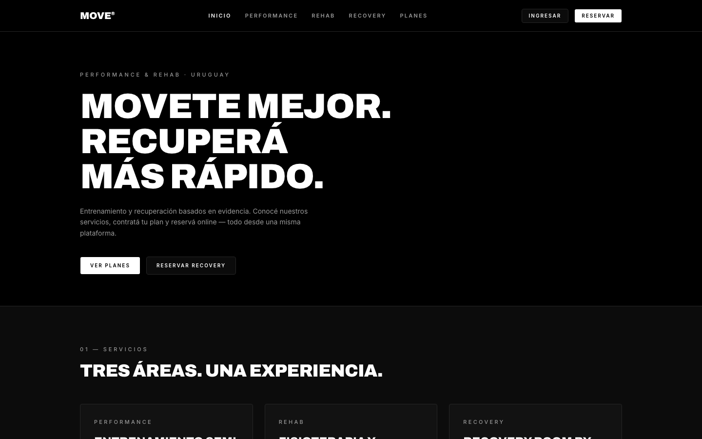

#### Performance

Entrenamiento semi personalizado por reserva, sin límite semanal de asistencias mientras tu plan esté vigente. La página muestra los planes y, más abajo, la sección **Horarios y cupos**.

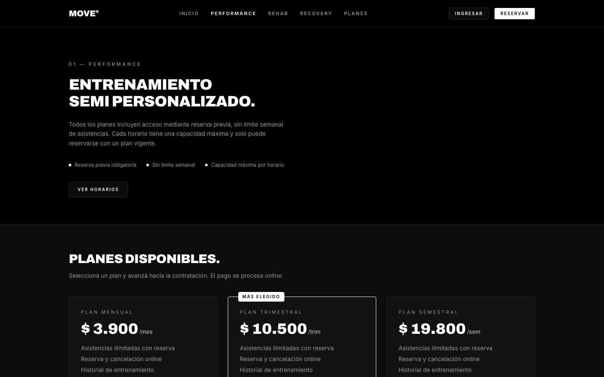

En **Horarios y cupos** elegís el día y ves cada horario con su cupo en tiempo real (por ejemplo, `5 / 14 cupos`). Para reservar necesitás un plan vigente; si tu plan venció, la plataforma bloquea nuevas reservas y te lleva a renovar.

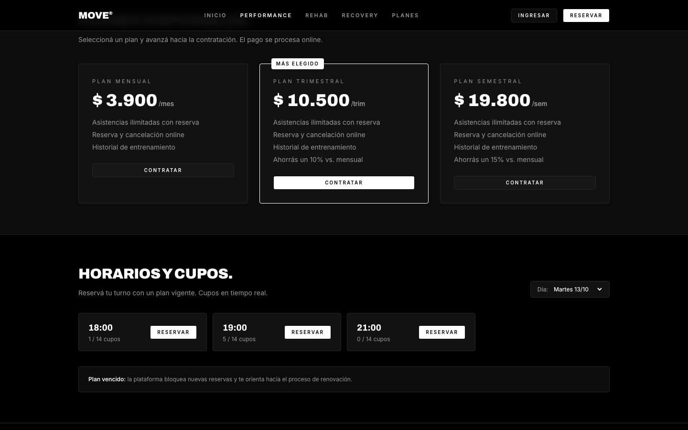

#### Rehab

La **Evaluación y Diagnóstico** es la puerta de entrada a fisioterapia. Está abierta a alumnos y a personas externas: si todavía no tenés cuenta, se crea durante el proceso. El tratamiento posterior lo define el equipo de MOVE después de la evaluación.

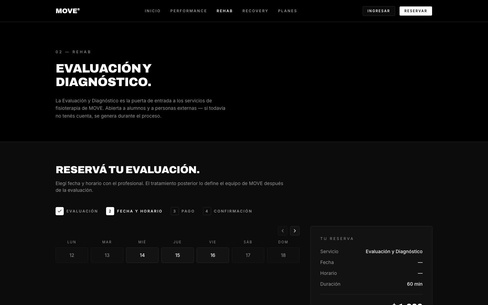

La reserva tiene cuatro pasos: **Evaluación → Fecha y horario → Pago → Confirmación**. Elegís el día y el horario, y el panel **Tu reserva** muestra el resumen y el total.

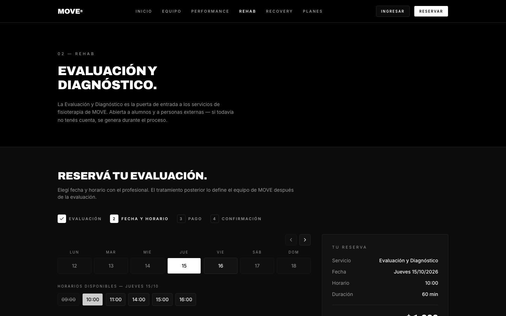

#### Recovery

Recovery Room by MOVE está abierta a todo público, sin plan previo. Podés pagar una **sesión individual** o contratar un **paquete** de 4 u 8 sesiones.

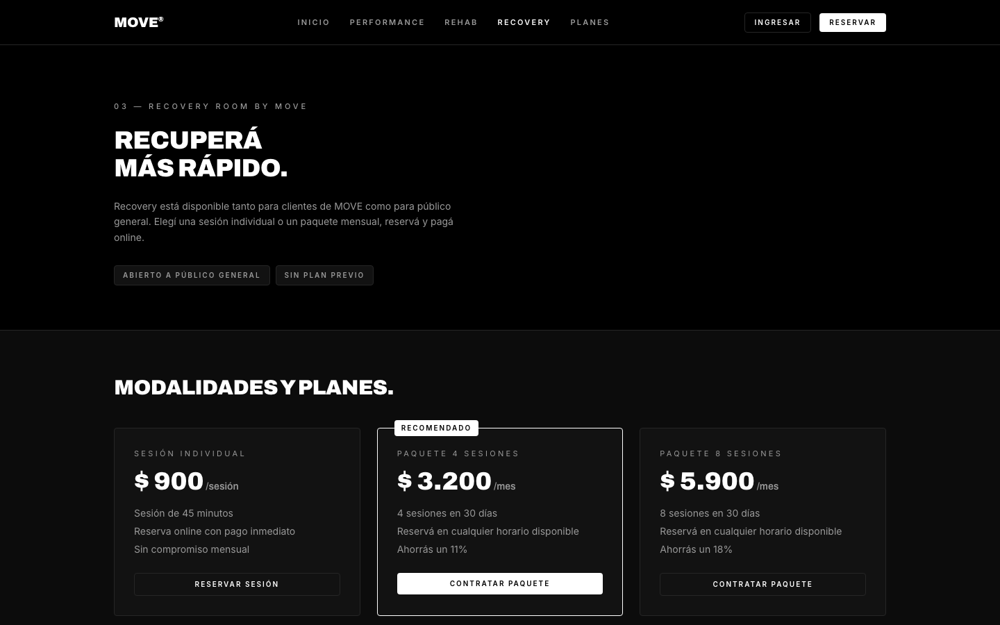

En **Reservá tu sesión** elegís la modalidad (**Sesión individual** o **Paquete**), el día y el horario. La sesión individual se paga en el momento y se puede reservar sin tener cuenta. Los paquetes duran 30 días desde la compra y las sesiones que no uses vencen al final.

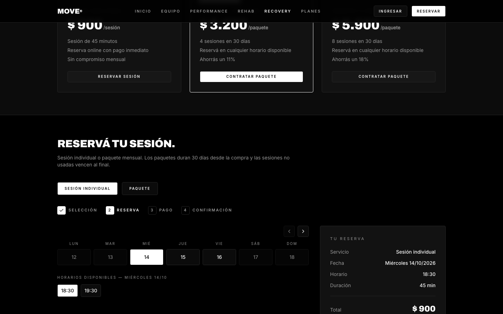

#### Planes

Compará los planes de Performance (Mensual, Trimestral, Semestral) y de Recovery. Con los botones **Todos / Performance / Recovery** filtrás por servicio. Los precios están en pesos uruguayos y los paquetes de Recovery muestran el precio **por paquete** (`/paquete`), no por sesión.

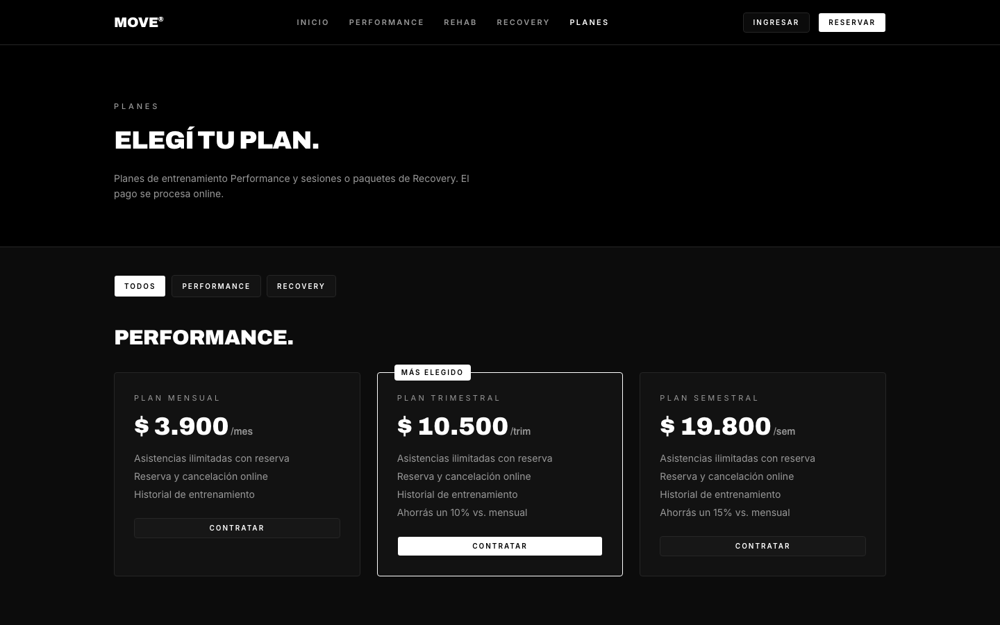

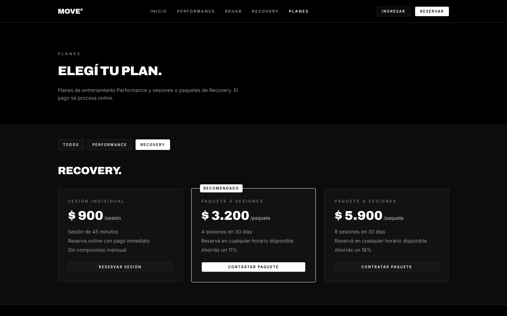

| Plan | Precio provisorio | Detalle |
|---|---|---|
| Plan Mensual (Performance) | $ 3.900 | 1 mes, asistencias ilimitadas con reserva |
| Plan Trimestral (Performance) | $ 10.500 | 3 meses |
| Plan Semestral (Performance) | $ 19.800 | 6 meses |
| Evaluación y Diagnóstico (Rehab) | $ 1.800 | 60 minutos |
| Sesión individual (Recovery) | $ 900 | 45 minutos |
| Paquete 4 sesiones (Recovery) | $ 3.200 | 4 sesiones en 30 días |
| Paquete 8 sesiones (Recovery) | $ 5.900 | 8 sesiones en 30 días |

#### Reservar

**Reservar** te pregunta qué querés reservar: Performance, Rehab o Recovery. Cada tarjeta lleva a su pantalla. Sin sesión iniciada es la misma pantalla; con sesión, el botón de la barra pasa a **Mi perfil**.

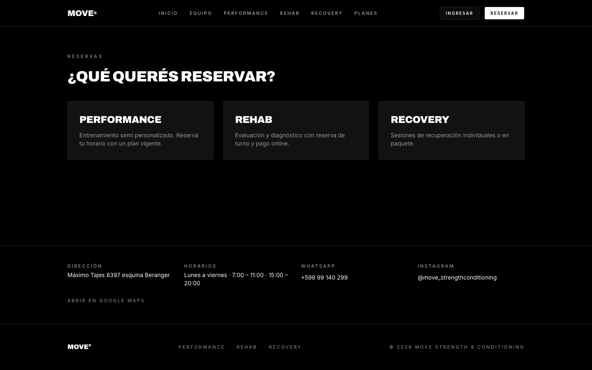


### Registro e ingreso

#### Ingresar y crear cuenta

La pantalla de acceso tiene dos pestañas: **Iniciar sesión** (email y contraseña) y **Crear cuenta**. Para crear la cuenta completás nombre y apellido, email, teléfono (opcional) y una contraseña de al menos 8 caracteres. No hace falta confirmar el email para ingresar. Hay una sola cuenta por email. Si un dato no es válido, el formulario lo marca debajo del campo con un texto en español (por ejemplo, "Revisá este valor."); nunca muestra mensajes técnicos del sistema. Lo mismo vale para los demás formularios de la plataforma.

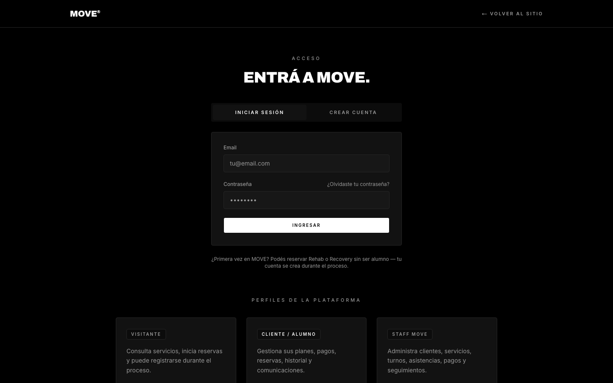

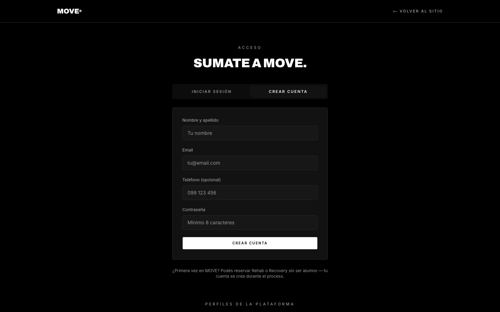

Si querés reservar Rehab o Recovery sin ser alumno, no hace falta registrarte antes: la cuenta se crea durante el proceso de reserva. Si ya tenés una cuenta con ese email, la plataforma te avisa "Ya tenés una cuenta con ese email: ingresá para continuar" y te pide **ingresar** (así nadie reserva a nombre de otra persona). Al ingresar volvés a la pantalla de reserva y elegís el horario de nuevo, ahora con tu cuenta: no queda ninguna reserva a medias.

**Volvés a donde estabas.** Si te piden ingresar cuando querías abrir una página (por ejemplo, el checkout de un plan o tu historial), después de ingresar la plataforma te lleva a **esa misma página**, con su dirección exacta, y no al inicio de tu perfil. Solo se vuelve a páginas internas permitidas para tu tipo de cuenta: un cliente nunca termina en el panel de staff, ni al revés.

> El botón de ingreso con Google está oculto: Google es una integración pendiente (ver [Google OAuth](#google-oauth-inicio-de-sesión-con-google)). Cuando esté activo, si intentás entrar con Google con un email que ya tiene una cuenta con contraseña, la pantalla de ingreso muestra **"Ya tenés una cuenta con ese email. Ingresá con tu contraseña."**: ingresá con tu contraseña.

#### Recuperar y restablecer la contraseña

Desde **¿Olvidaste tu contraseña?** ingresás tu email y recibís un link para elegir una contraseña nueva (el link vale 1 hora). Si tu cuenta todavía no tiene contraseña (por ejemplo, se creó al reservar como invitado o solo ingresaste con Google), el email que recibís es el de invitación, con un link de 72 horas para definir tu primera contraseña.

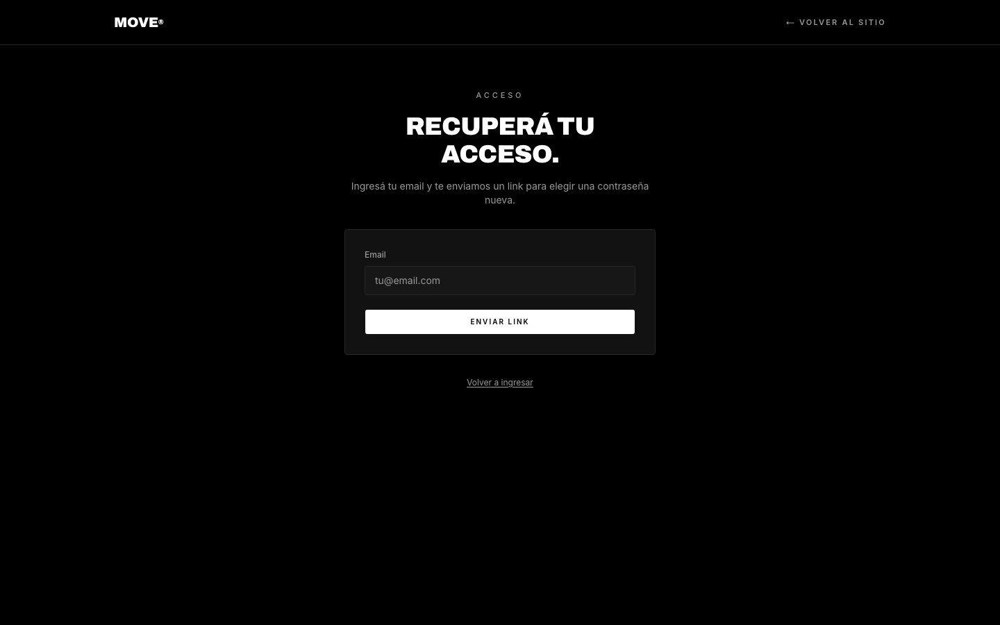

El link abre la pantalla **Nueva contraseña**. Si el link está vencido o no es válido (como en la captura, que se abrió sin link), podés **Pedir un link nuevo**. Al restablecer, se cierran las sesiones abiertas de esa cuenta.

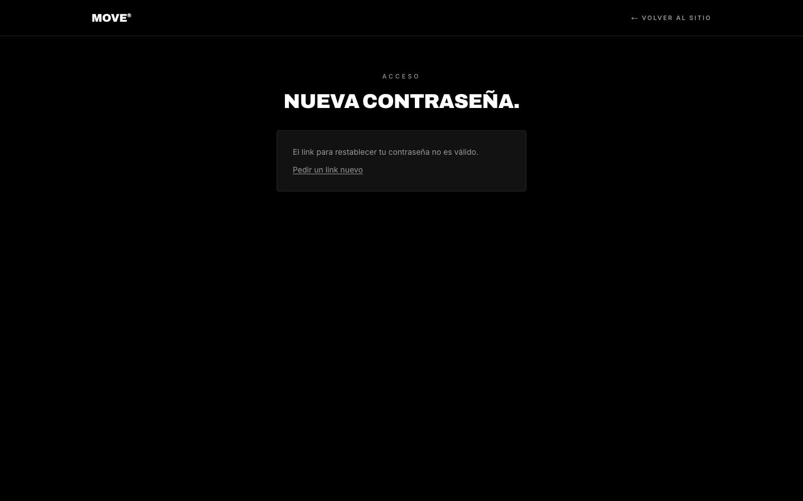

#### Continuar

Después de ingresar, la plataforma te lleva sola al lugar correcto: los clientes a **Mi perfil** y el staff al panel. Si abrís la pantalla sin sesión activa, ves el aviso "Tu sesión no está activa" con el enlace **Ingresar**.


### Contratar un plan

Para contratar un plan de Performance o un paquete de Recovery tenés que haber ingresado. Desde **Planes** o desde tu perfil, tocá **Contratar**: ves el resumen (precio, período o sesiones) y **Pagar con Mercado Pago**.

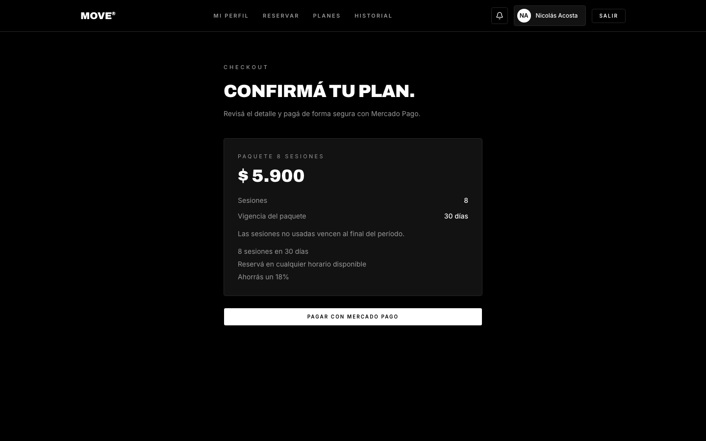

Si renovás antes de que venza tu plan, el nuevo período empieza el día siguiente al vencimiento (no perdés días). En el ambiente de desarrollo, en lugar de Mercado Pago aparece un **simulador de pagos** donde se aprueba o se rechaza la operación; en producción lo reemplaza Mercado Pago.

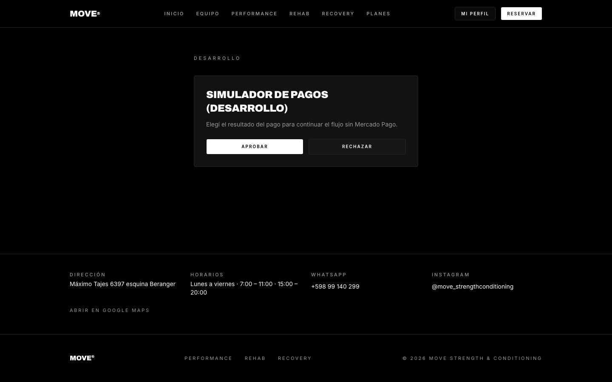

Cuando el pago se aprueba, ves el resultado y podés ir a tu perfil: el plan queda activo en el momento.

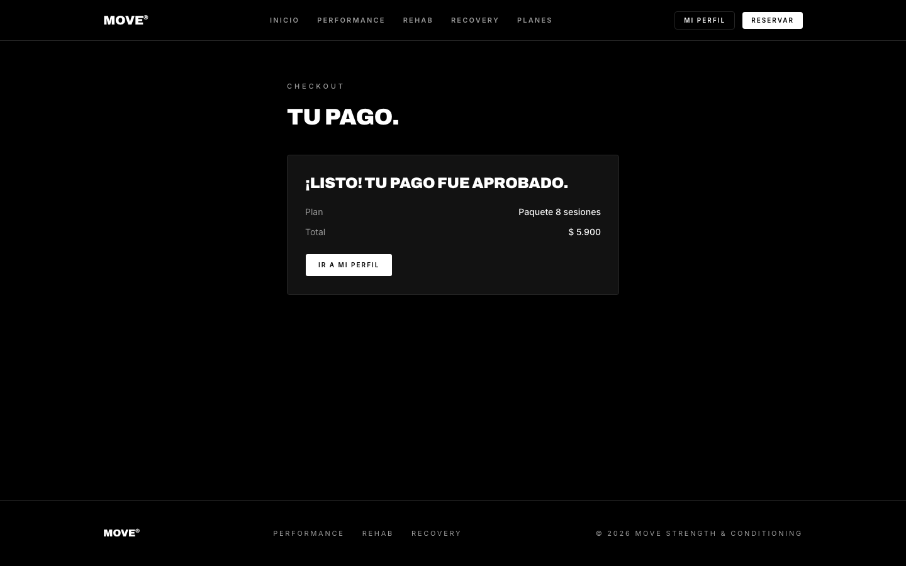

Si el pago de un plan sigue pendiente después de la espera (por ejemplo, porque Mercado Pago tarda en acreditarlo), la pantalla te muestra "Confirmando tu pago" mientras espera y, pasado un minuto aproximadamente, **"Pago en proceso"**: "Tu pago está en proceso. Te avisamos por email cuando se acredite." Debajo aparece **Intentar de nuevo**, que te lleva otra vez al checkout de ese plan para probar con otro medio de pago. Si el pago fue rechazado o no se completó, la pantalla muestra enseguida "Pago no completado" y el botón **Intentar de nuevo** también aparece ahí.

**Límites del checkout.** Para evitar abusos, cada persona puede tener como máximo **2 reservas pendientes de pago** a la vez: si intentás una tercera, ves "Ya tenés reservas pendientes de pago. Completá el pago o esperá a que venzan." (las retenidas vencen a los 15 minutos). Además, el checkout acepta hasta 10 intentos por minuto desde una misma conexión y, al reservar una sesión de Rehab o Recovery, hasta 20 intentos por hora desde esa misma conexión: si superás cualquiera de los dos límites, ves "Hiciste demasiados intentos. Esperá un rato y probá de nuevo." Los intentos se cuentan por conexión a internet: las personas que usan la misma red (por ejemplo, el wifi del gimnasio) comparten el límite.

### Mi perfil

Es tu pantalla principal. Muestra:

- **Tu plan de Performance** (estado Activo, Por vencer o Vencido), desde cuándo está vigente, cuándo vence, el progreso del período y el botón **Renovar plan**.
- **Paquetes Recovery**: cuántas sesiones te quedan y cuándo vence el paquete.
- **Próximas reservas**, cada una con su botón **Cancelar**. Una reserva que está retenida esperando el pago (por ejemplo, una evaluación de Rehab que todavía no pagaste) muestra el aviso **Pago pendiente**; si no se completa el pago a tiempo, la reserva se libera sola.
- **Reservar**: accesos directos a Performance y Recovery.
- **Avisos** (también desde la campana de arriba): plan por vencer o vencido, check-in pendiente o respondido y paquete con pocas sesiones.
- **Tu mes en MOVE**: asistencias del mes y veces por semana.

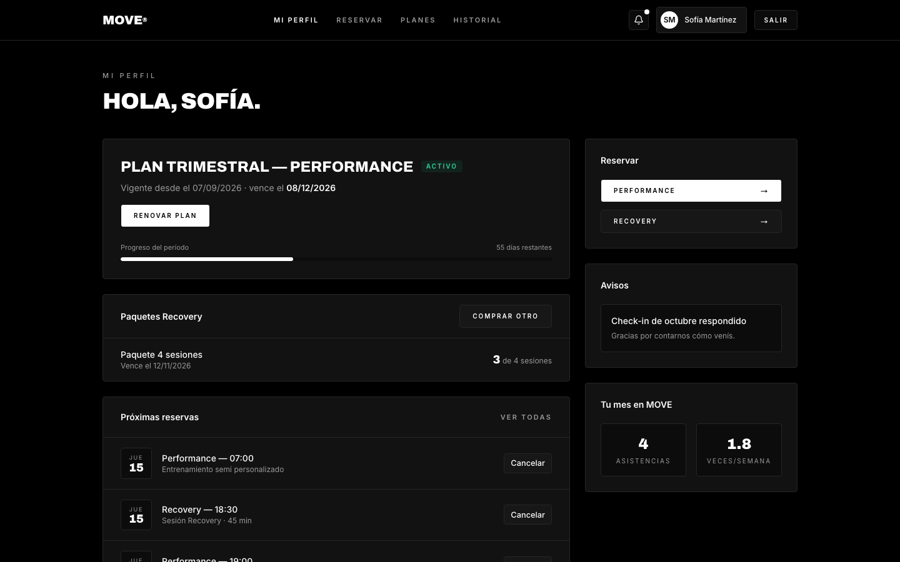

**Reservar Performance.** Con un plan vigente, elegí el día y el horario en **Performance → Horarios y cupos** (o desde **Reservar**). Podés reservar hasta 14 días hacia adelante. Si el turno se llenó, la plataforma avisa que está completo; si no tenés plan vigente, avisa que necesitás uno.

**Cancelar.** Podés cancelar una reserva de tu plan de Performance, de tu paquete de Recovery o de seguimiento fisioterapéutico hasta **2 horas antes** del turno. Las reservas que pagaste individualmente (la Evaluación de Rehab y la sesión individual de Recovery) no se cancelan online: escribile a MOVE y el equipo las cancela.

**Reservar Rehab (evaluación).** Seguí los cuatro pasos de la pantalla de Rehab. Si todavía no tenés cuenta se crea en el proceso. El turno queda retenido mientras pagás (15 minutos); si no se completa el pago, el turno se libera.

**Reservar Recovery.** Con un paquete activo reservás tus sesiones eligiendo día y horario (se descuentan del paquete). Sin paquete, elegís sesión individual o contratás uno.

### Seguimiento fisioterapéutico

Después de la evaluación (o si el equipo te deriva a Rehab), el staff **habilita el seguimiento fisioterapéutico** en tu cuenta. Entonces podés reservar tus turnos de Rehab desde **Reservar → Fisioterapia**, con la disponibilidad del profesional, sin pago online.

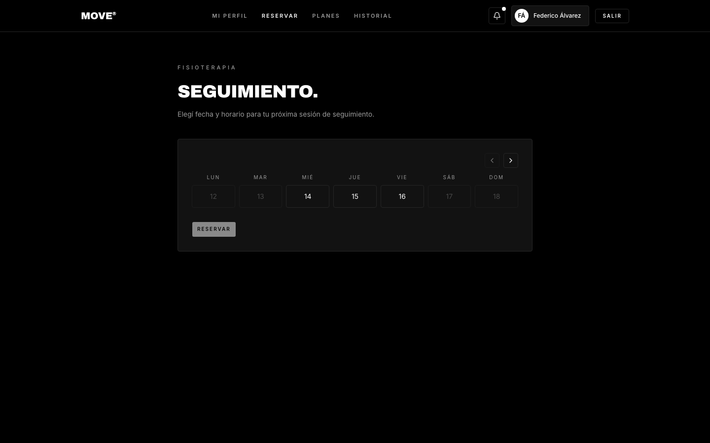

Elegís el día y aparecen los horarios disponibles; confirmás con **Reservar**. Si tu cuenta no tiene el seguimiento habilitado, la plataforma te avisa que no está habilitado.

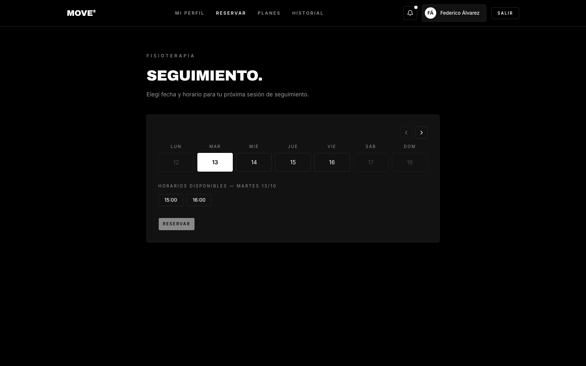

### Historial

Lista tu actividad (reservas, pagos, asistencias, ausencias, no shows y cancelaciones), de la más reciente a la más antigua. Con **Todo / Reservas / Pagos** filtrás el tipo de movimiento.

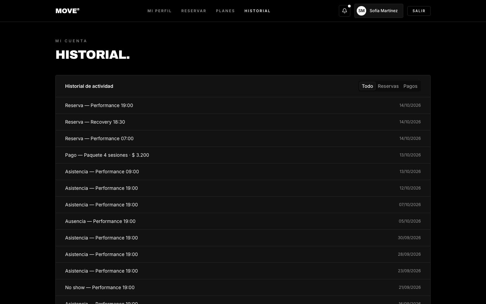

### Check-in mensual

Si tenés un plan de Performance vigente y no estás en pausa, una vez por mes recibís un email con el link al **check-in**: tres preguntas de un minuto (cómo te sentís con el entrenamiento, si sentiste alguna molestia y si cambiaron tus objetivos). Si contás una molestia o querés ajustar objetivos, el equipo lo ve y se comunica con vos.

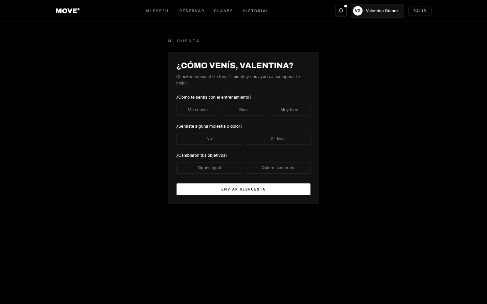

---

## Parte 2: Staff de MOVE

Ingresá desde **Ingresar** con tu usuario de staff: la plataforma te lleva al panel. La barra lateral tiene **Dashboard**, **Clientes**, **Turnos y asistencia**, **Pagos**, **Seguimiento** (con un número de alertas abiertas y el subitem **Check-in**) y **Configuración**. En el celular la barra lateral se reemplaza por un botón de menú (☰) arriba a la izquierda, con las mismas secciones. Los servicios se llaman igual en todo el panel: **Performance**, **Fisioterapia** (Rehab) y **Recovery**. Los usuarios de staff los crea el equipo técnico (ver [Primer staff de producción](#primer-staff-de-producción)); los clientes no pueden entrar al panel.

El botón de confirmación de las acciones que **cancelan o eliminan** algo en el panel (**Cancelar reserva**, **Cancelar turno**, **Eliminar** un plan) es siempre el mismo: rojo y en mayúsculas, dentro de un diálogo que pide confirmar antes de hacer nada. **Eliminar** también aparece en rojo en la tabla de planes. En **Turnos y asistencia**, el **Cancelar** de cada alumno es un botón gris que se pone rojo al pasar el mouse, y **Cancelar turno** está en el menú **⋯** del turno; los dos abren ese diálogo de confirmación.

### Dashboard

Resume el día: un aviso si hay turnos con asistencia pendiente de marcar, los números de clientes (activos, planes por vencer en los próximos 7 días, inactivos y asistencias de hoy), los contadores de **alertas abiertas** por tipo y la tabla **Turnos de hoy** con el enlace **Ver turno**.

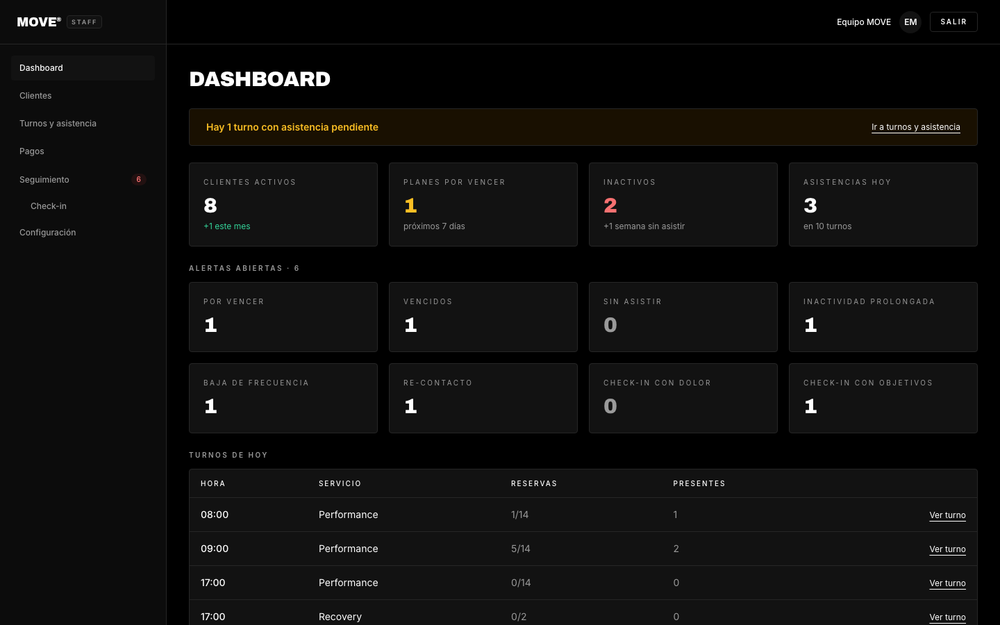

### Clientes

La lista muestra a todos los clientes con su estado, plan, vencimiento, estado de pagos, última asistencia, frecuencia semanal y cantidad de turnos de Rehab y Recovery. Podés buscar por nombre, email o plan (sin importar mayúsculas ni tildes) y filtrar por estado: **Activos**, **Por vencer**, **Inactivos**, **Vencidos**, **Pausados** y **Sin plan**.

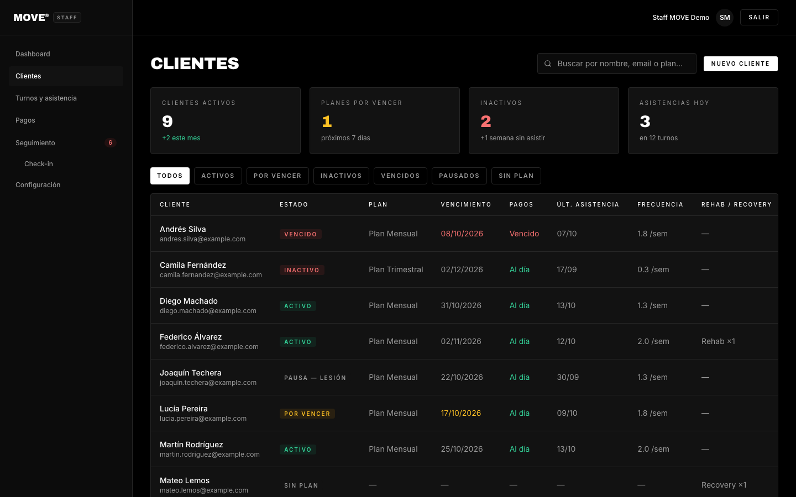

| Estado | Qué significa |
|---|---|
| Activo | Plan vigente y con asistencia reciente |
| Por vencer | El plan vence dentro del plazo de aviso (7 días, provisorio) |
| Vencido | El plan terminó y no se renovó |
| Inactivo | Plan vigente, pero lleva varios días sin asistir (según las reglas de seguimiento) |
| Pausa | Hay un motivo de inactividad registrado (lesión, vacaciones, etc.) |
| Sin plan | Tiene cuenta, pero nunca tuvo un plan de Performance |

#### Nuevo cliente

**Nuevo cliente** crea la cuenta con nombre, email y teléfono (opcional). El cliente recibe un email para definir su contraseña. Si el email ya existe, la plataforma avisa que ya hay una cuenta.

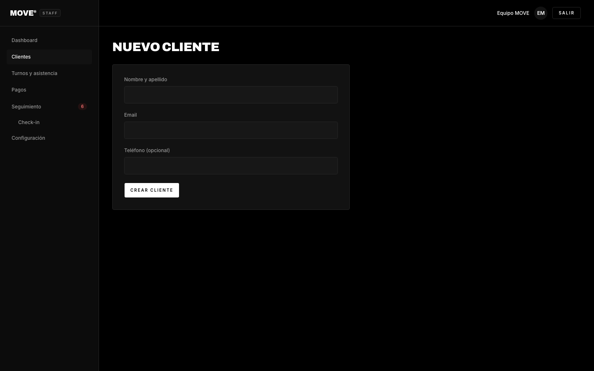

#### Detalle del cliente

Al abrir un cliente ves su plan y paquetes, las **métricas** (frecuencia semanal, asistencias del mes, última asistencia, cancelaciones, no shows y turnos de Rehab y Recovery), los contactos que ya se hicieron, el historial y las próximas reservas. Desde acá también podés:

- **Habilitar el seguimiento fisioterapéutico**, con el interruptor de arriba a la derecha: el cliente podrá reservar turnos de Rehab desde su perfil.
- **Registrar un motivo** de inactividad (Lesión, Vacaciones, Pausa temporal, Falta de tiempo, Mudanza o Quiere volver más adelante), con una nota interna y, si querés, una fecha de re-contacto. Registrar un motivo **pausa** al cliente: no recibe alertas ni emails automáticos hasta que termine la pausa, y la plataforma te avisa el día de re-contacto.

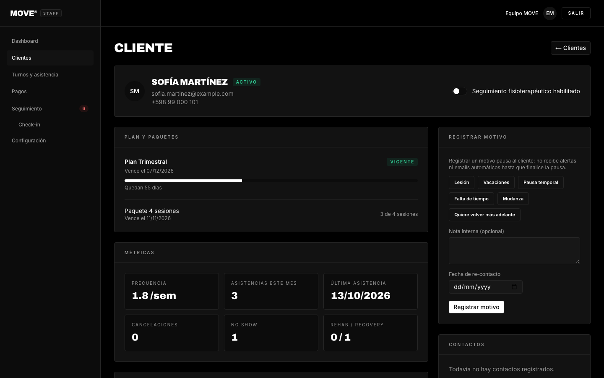

### Turnos y asistencia

Elegí el día (con las flechas o el calendario) y el servicio (**Performance**, **Recovery** o **Fisioterapia**). Los botones de horario cambian de turno. Arriba se ve cuántas reservas tiene (`5/14`), cuántos presentes, cuántos ausentes y no shows y las cancelaciones; abajo, la lista de alumnos con su plan, su última asistencia y su estado.

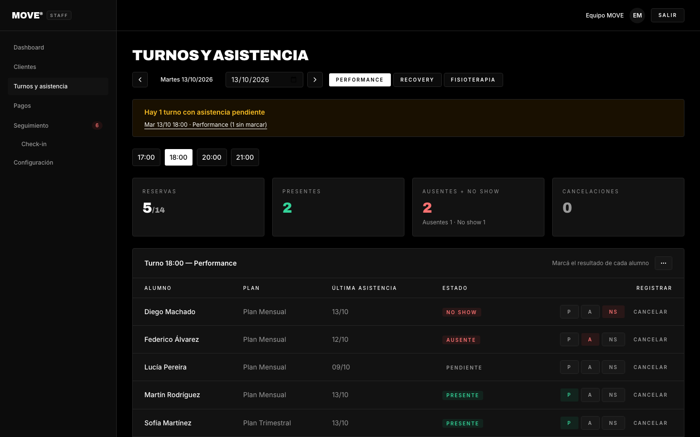

En el celular cada alumno se muestra como una **tarjeta** (nombre, plan, última asistencia y estado) con **P**, **A**, **NS** y **Cancelar** a la vista, sin deslizar la tabla hacia los costados.

**Marcar asistencia.** Con los botones de cada alumno:

| Botón | Estado | Cuándo usarlo |
|---|---|---|
| **P** | Presente | Vino al turno |
| **A** | Ausente | No vino, pero avisó fuera de plazo |
| **NS** | No show | No vino y no avisó |

Ninguno tiene penalidad por ahora. Sin marcar, el alumno figura como **Pendiente** y el turno aparece en el aviso amarillo de "turno con asistencia pendiente". La asistencia se puede registrar una vez que el turno empezó. Con **Cancelar** el staff cancela la reserva de un alumno (por ejemplo, las que el cliente no puede cancelar online). El menú **⋯** del turno permite cambiar el cupo (nunca por debajo de las reservas activas) y cancelar el turno (solo si no tiene reservas activas).

> Solo los clientes reservan: el staff no reserva en nombre de un cliente; sí cancela y marca asistencia.

### Pagos

Lista las operaciones, de la más reciente a la más antigua, con cliente, ítem, servicio, monto, método (Mercado Pago, efectivo o transferencia) y estado. Filtrá por **Estado** (Aprobados, Pendientes, Rechazados, Expirados), por **Método** o con **Requieren atención**.

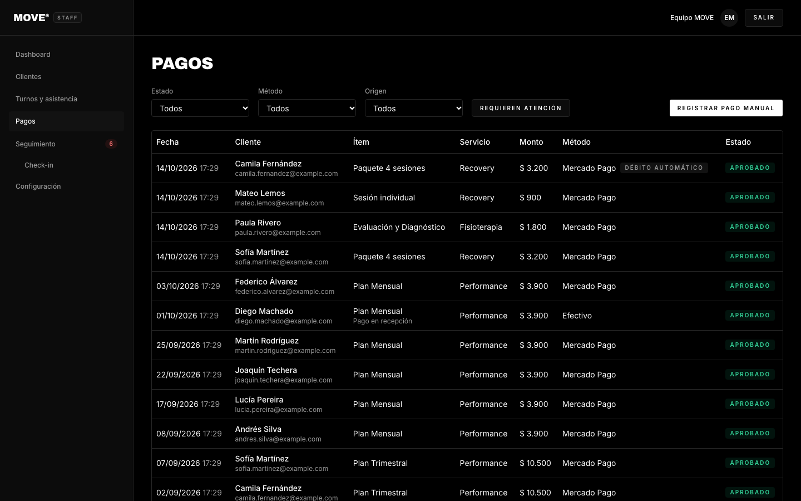

En el celular cada operación se muestra como una **tarjeta** con sus datos (fecha, cliente, ítem, servicio, monto, método y estado), y los filtros y **Registrar pago manual** quedan a la vista sin deslizar.

**Requieren atención** reúne las compras que quedaron aprobadas pero que el sistema no pudo completar sola: por ejemplo, si un pago se aprobó cuando la reserva retenida ya había vencido y el turno ya no tenía cupo. El staff las resuelve a mano (por ahora no hay reembolso automático).

#### Registrar un pago manual

**Registrar pago manual** sirve para cobros en efectivo o por transferencia. Buscá al cliente por nombre o email, elegí el plan, el método, el monto y, si querés, una nota. Al registrarlo, el plan o paquete **se activa en el momento**.

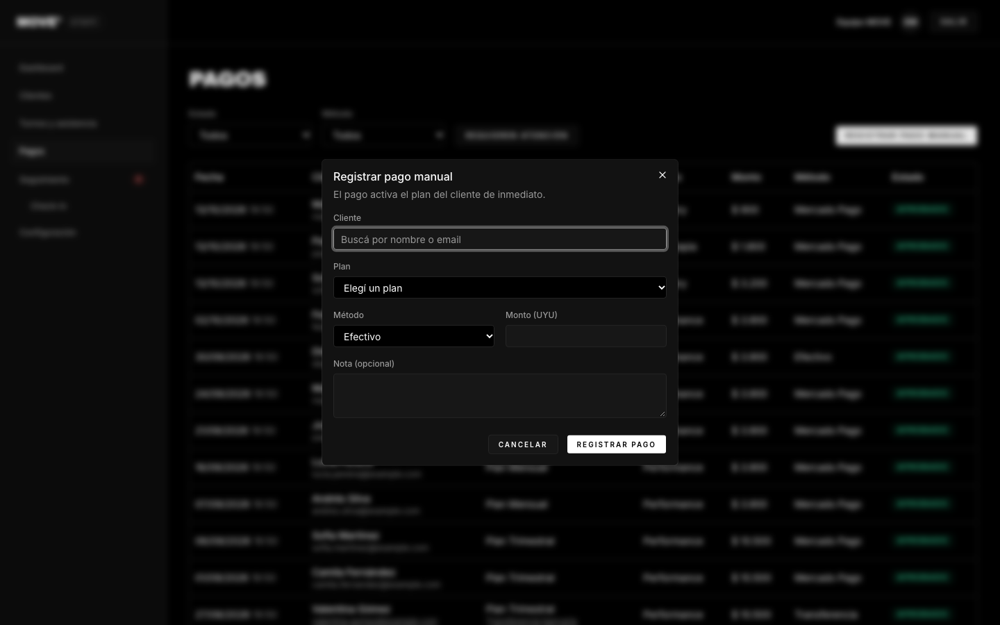

### Seguimiento y check-ins

#### Alertas de seguimiento

Cada día la plataforma revisa a los clientes y abre alertas cuando algo requiere atención del equipo. Los filtros de arriba muestran cuántas hay de cada tipo:

| Alerta | Cuándo aparece (valores provisorios) |
|---|---|
| Por vencer | El plan vence en los próximos 7 días |
| Vencidos sin renovar | El plan terminó y no se renovó |
| 1 semana sin asistir | 7 días sin asistir |
| Inactividad prolongada | 21 días sin asistir |
| Baja de frecuencia | Promedio de las últimas 2 semanas menor al 50 % del de las 8 semanas anteriores |
| Re-contactar | Llegó la fecha de re-contacto de un cliente en pausa |
| Molestia reportada | El cliente contó una molestia en su check-in |
| Cambio de objetivos | El cliente quiere ajustar sus objetivos en su check-in |

Correr la detección dos veces el mismo día no duplica alertas. El botón **Ejecutar detección ahora** la corre en el momento.

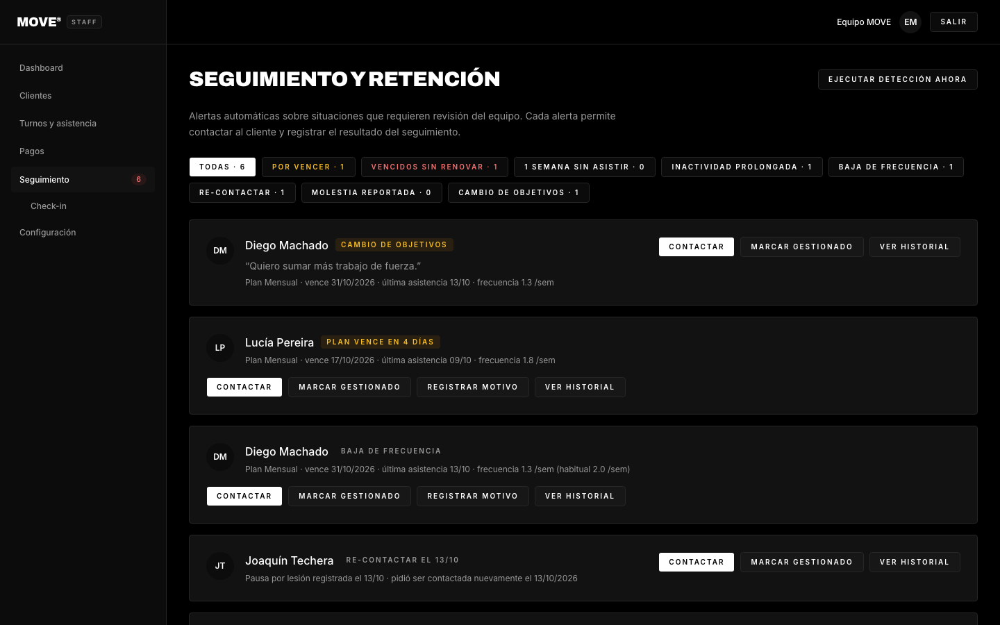

En cada alerta podés:

- **Contactar**: registrás el canal (Teléfono, WhatsApp, Email o En persona), el resultado (Habló con la persona, No respondió o Dejé un mensaje) y una nota. Queda en el historial del cliente.
- **Marcar gestionado**: cierra la alerta.
- **Registrar motivo**: pausa al cliente con un motivo de inactividad.
- **Ver historial**: abre el detalle del cliente.

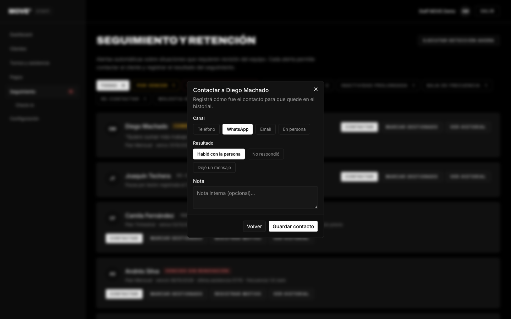

#### Check-in de clientes

El check-in mensual se envía por email el primer lunes de cada mes (10:00, hora de Montevideo) a los clientes con plan de Performance vigente que no estén en pausa; un cliente recibe como máximo uno por mes. Con **Enviar check-in** el staff lo puede enviar a mano; si se repite el mismo mes, no duplica nada y solo manda las invitaciones que todavía no se habían enviado (los clientes en pausa o dados de baja no reciben nada).

La pantalla muestra a la izquierda la **vista previa** de lo que ve el alumno y, a la derecha, los números del mes (enviados, respondidos y que requieren intervención) y las respuestas. **Requieren intervención** cuenta solo los check-ins cuya alerta (molestia o cambio de objetivos) sigue abierta: si la alerta de molestia ya se gestionó, ese check-in deja de contar, aunque la alerta de objetivos del mismo check-in siga abierta (ver [Deuda conocida](#deuda-conocida-y-comportamientos-a-tener-presentes)). Si el cliente contó una molestia, la respuesta tiene **Derivar a Rehab**: habilita el seguimiento fisioterapéutico de ese cliente, marca como gestionada la alerta de molestia y le envía un email con el link para reservar su turno de Rehab.

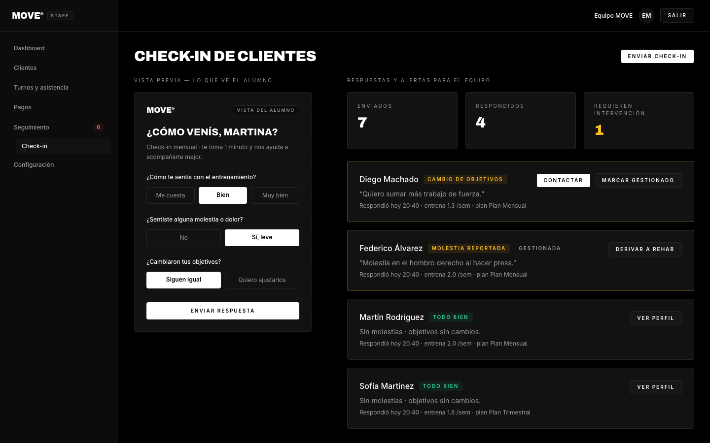

### Configuración

La configuración tiene cuatro pestañas.

#### Planes

Alta, edición, desactivación y baja de los planes y paquetes, agrupados por servicio (Performance, Fisioterapia y Recovery): nombre, precio, período o sesiones y destacado. El identificador (slug) de un plan eliminado se puede reutilizar en un plan nuevo.

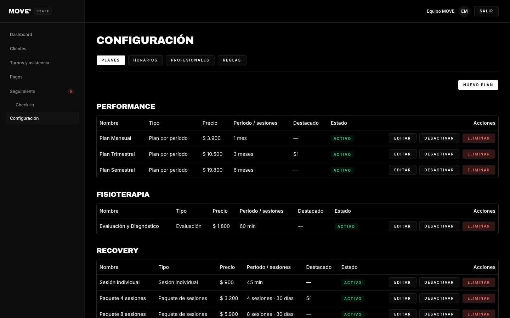

#### Horarios

Los turnos de Performance y Recovery se generan a partir de **horarios semanales** (día, hora, duración, cupo). **Nuevo horario** agrega uno, **Desactivar** deja de generar turnos con él (los ya generados quedan), **Generar turnos ahora** corre la generación y **Turno puntual** crea un turno suelto en una fecha. Un cambio en un horario solo afecta a los turnos que se generen después.

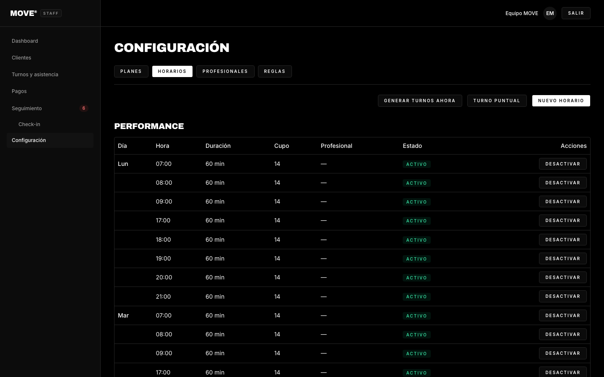

#### Profesionales

Lista de profesionales de Rehab. Los turnos de Rehab son de un profesional y tienen cupo 1.

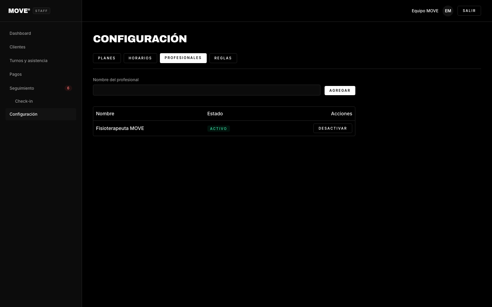

#### Reglas y valores provisorios

Acá se editan los umbrales del sistema: horas para cancelar (2), días de reserva anticipada (14), minutos de reserva pendiente de pago (15), minutos para conciliar pagos (10), días para "por vencer" (7), días sin asistir (7), días de inactividad prolongada (21), ratio de baja de frecuencia (0,5), semanas recientes (2) y de referencia (8), y si se envía el check-in mensual.

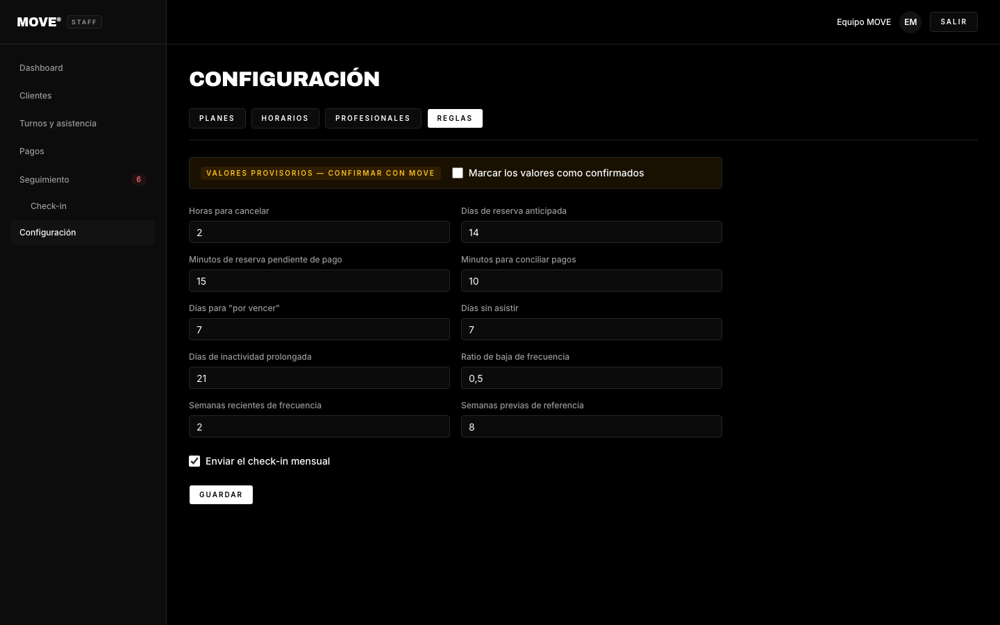

Mientras el aviso **"Valores provisorios — confirmar con MOVE"** esté visible, los planes, precios, horarios y umbrales son los del mockup y **no están confirmados**. Cuando MOVE los defina, se editan en estas pestañas y se tilda **Marcar los valores como confirmados**.

---

## Parte 3: Cómo levantar todo

### Arquitectura

MOVE es un monorepo con dos aplicaciones: la web (`apps/web`, Next.js) y la API (`apps/api`, NestJS + PostgreSQL). La web muestra las pantallas; la API tiene toda la lógica, los datos, el inicio de sesión (Better Auth), los pagos, los emails y los jobs programados. En producción la web va en Vercel, la API en AWS Elastic Beanstalk y la base en Neon:

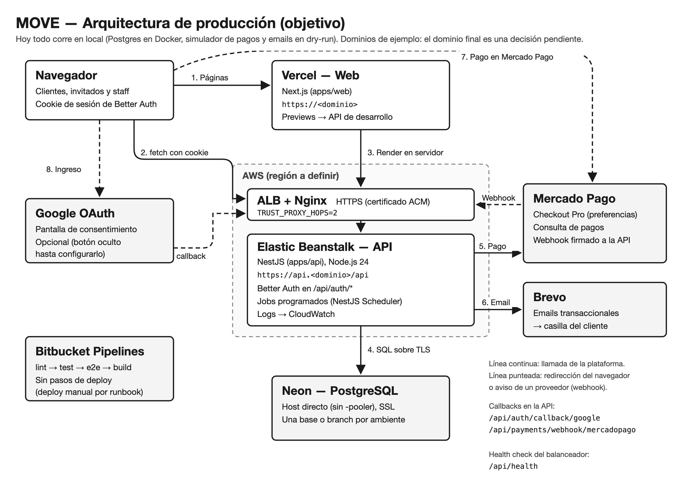

1. El navegador pide las páginas a la web (Vercel).
2. Las pantallas llaman a la API directamente, con la cookie de sesión.
3. La web también llama a la API desde el servidor (Server Components), reenviando la misma cookie. Por eso web y API tienen que compartir el dominio raíz (ver [Dominio y cookies](#dominio-y-cookies)).
4. La API guarda todo en PostgreSQL (Neon) por una conexión con SSL.
5. Para cobrar, la API crea una preferencia en Mercado Pago y consulta los pagos; Mercado Pago avisa cada pago a la API con un webhook firmado.
6. La API manda los emails por Brevo.
7. El navegador paga en la página de Mercado Pago y vuelve a la web (`/checkout/resultado`).
8. Con Google, el navegador pasa por la pantalla de consentimiento y Google vuelve a la API (`/api/auth/callback/google`).

Hoy **nada de esto está en la nube**: todo corre en una computadora, con Postgres en Docker y reemplazos de desarrollo para los proveedores:

| Pieza | En local, sin credenciales | Con credenciales |
|---|---|---|
| Base de datos | Postgres 17 en Docker (`pnpm db:up`, contenedor `move-postgres`) | Neon |
| Mercado Pago | **Simulador de pagos**: el checkout lleva a `/checkout/simulado`, donde se aprueba o rechaza la compra. Solo existe sin `MP_ACCESS_TOKEN` y con `NODE_ENV` distinto de `production` (en producción la API ni siquiera lo monta) | Checkout Pro real, webhook y conciliación |
| Brevo | **Dry-run**: no sale ningún email; cada uno queda en la tabla `email_logs` con estado `skipped` y como línea de log (`email skipped <plantilla> user=<id>`), sin datos personales | Envío real |
| Google | Botón oculto | Botón **Continuar con Google** |
| Jobs | Corren dentro de la API, igual que en producción | Igual |

### Local, paso a paso

Para una prueba rápida con datos de demostración, seguí [Probar MOVE en local](#probar-move-en-local). Esta sección explica cada pieza con más detalle.

Requisitos: Node 24 (`nvm use` lee `.nvmrc`), pnpm 10 (`corepack enable`) y Docker.

1. **Instalar.** Desde la raíz del repo:

   ```bash
   pnpm install
   ```

2. **Variables de entorno.** La API valida sus variables al arrancar y no arranca si falta una obligatoria. Hay dos formas de dárselas:

   - Copiar los ejemplos, que traen valores de desarrollo listos para usar (web en el puerto 3000, API en el 3001):

     ```bash
     cp apps/api/.env.example apps/api/.env
     cp apps/web/.env.example apps/web/.env.local
     ```

   - O exportar esas mismas variables en el shell, sin crear archivos (la API, las migraciones, el seed y los scripts del manual leen el entorno del proceso): `set -a; . apps/api/.env.example; set +a`. Las variables exportadas tienen prioridad sobre las de un `.env`. Hace falta `NODE_ENV=development`: ya viene en el ejemplo. Cargá el ejemplo **solo en las consolas de la API y de los scripts del manual**, nunca en la de la web: trae `PORT=3001` y la web toma su puerto de `PORT`. En la consola de la web exportá solo `NEXT_PUBLIC_API_URL` (o corré antes `unset PORT`).

   La web necesita `NEXT_PUBLIC_API_URL=http://localhost:3001/api` (está en `apps/web/.env.example`). La lista completa de variables está en [Variables por proveedor](#variables-por-proveedor).

3. **Postgres, esquema y datos iniciales.**

   ```bash
   pnpm db:up                                # Postgres 17 en Docker (contenedor move-postgres, puerto 5432)
   pnpm --filter @move/api migration:run     # crea el esquema; en una base existente aplica las migraciones nuevas
   pnpm --filter @move/api seed              # planes, horarios y configuración provisorios (idempotente)
   ```

4. **Primer usuario de staff.** La contraseña va por variable de entorno, nunca por argumento:

   ```bash
   printf 'Contraseña del staff: '; read -rs CREATE_STAFF_PASSWORD && export CREATE_STAFF_PASSWORD; echo
   pnpm --filter @move/api user:create-staff -- --email staff@example.com --name "Nombre Apellido"
   unset CREATE_STAFF_PASSWORD
   ```

   El comando imprime solo el id. La contraseña debe tener al menos 8 caracteres y el nombre entre 2 y 80. Si ya existe una cuenta con ese email, el comando **se niega** y avisa:

   ```text
   Ya existe una cuenta con ese email; usá --promote-existing para convertirla en staff.
   ```

   Con `--promote-existing` esa cuenta se convierte en staff, se le fija la contraseña indicada, se marca su email como verificado y se cierran todas sus sesiones abiertas; el comando avisa que reutilizó una cuenta existente. `--name` sigue siendo obligatorio, pero con `--promote-existing` el nombre de la cuenta no cambia.

   ```bash
   pnpm --filter @move/api user:create-staff -- --email persona@example.com --name "Nombre Apellido" --promote-existing
   ```

5. **API y web.**

   ```bash
   pnpm dev          # web en :3000 y API en :3001 (o por separado: pnpm dev:api y pnpm dev:web)
                     # con las variables exportadas en el shell, usá consolas separadas: `pnpm dev` pasaría PORT=3001 también a la web
   curl http://localhost:3001/api/health      # {"status":"ok"}
   ```

   Al arrancar, la API genera los turnos de los próximos días a partir de los horarios del seed (si `SCHEDULER_ENABLED` no es `false`).

6. **Recorrer la plataforma.** Registrá un cliente en `http://localhost:3000/registro`, contratá un plan desde **Planes**, aprobá el pago en el **simulador** (`/checkout/simulado`) y reservá un turno de Performance. Con el usuario de staff abrí `http://localhost:3000/staff` y marcá la asistencia en **Turnos y asistencia**. El simulador llama a `POST /api/payments/dev/simulate`; un pago rechazado deja la compra pendiente para reintentar.

7. **Ver los emails en dry-run.** Los emails no salen, pero quedan registrados (solo plantilla, usuario y estado; nunca el contenido ni el link):

   ```bash
   docker exec move-postgres psql -U move -d move \
     -c "SELECT template, status, created_at FROM email_logs ORDER BY created_at DESC LIMIT 10"
   ```

   Como el link no se guarda, en dry-run no se puede completar un restablecimiento de contraseña ni la invitación de un cliente nuevo: para probar esos flujos de punta a punta hace falta Brevo configurado (ver [Brevo](#brevo-emails)).

8. **Correr un job a mano.** Desde el panel: **Seguimiento → Ejecutar detección ahora** (`followup-detect`), **Configuración → Horarios → Generar turnos ahora** (`generate-slots`) y **Seguimiento → Check-in → Enviar check-in** (envío manual de check-ins). Cualquier job también se corre con sesión de staff:

   ```bash
   curl -X POST http://localhost:3001/api/staff/automations/run/<job> --cookie "<cookie de sesión del staff>"
   ```

   Jobs: `followup-detect`, `checkins-monthly`, `expiry-reminders`, `generate-slots`, `expire-holds` y `reconcile-payments`. La cookie se copia del header `Cookie` de cualquier request a la API en las herramientas de desarrollo del navegador. La corrida manual funciona aunque `SCHEDULER_ENABLED=false`, usa el mismo lock que el cron y es idempotente.

9. **Tests.**

   ```bash
   pnpm lint                                              # oxlint (API) y ESLint (web)
   pnpm test                                              # unit de la API y de la web
   docker exec move-postgres createdb -U move move_test   # una sola vez
   E2E_DATABASE_NAME=move_test pnpm test:e2e              # e2e de la API contra Postgres (base dedicada)
   pnpm build
   ```

   Más detalle en [`docs/development.md`](../development.md).

   **Pruebas end to end de la web (con navegador).** Además de lo anterior, la web tiene una suite de Playwright que recorre las pantallas en escritorio y en celular. Corre con `pnpm e2e:reset && pnpm test:e2e:web` sobre una base propia (`move_e2e`) y puertos propios (API 3150, web 3250); las contraseñas del staff y de los clientes de prueba se pasan por las variables `E2E_STAFF_PASSWORD` y `E2E_CLIENT_PASSWORD`, nunca en un archivo. El navegador se instala una sola vez con `pnpm exec playwright install chromium`, y la suite no corre en el pipeline de Bitbucket. Los pasos completos están en [Pruebas end to end](../development.md#pruebas-end-to-end) de `docs/development.md`.

### Producción, en orden

Nada de esto se ejecutó todavía. Cada paso remite a su proveedor en la [Parte 4](#parte-4-proveedores-uno-por-uno); el runbook técnico con los comandos está en [`docs/deploy.md`](../deploy.md).

1. **Decidir los dominios** (hoy pendientes): el de producción y un dominio registrable distinto para desarrollo ([Ambientes separados](#ambientes-separados-de-desarrollo-y-producción)).
2. **Conseguir los accesos** de la tabla [Accesos necesarios](#accesos-necesarios).
3. **Neon:** una base por ambiente, SSL, host directo ([Neon](#neon-base-de-datos)).
4. **Generar el paquete de la API**, correr las migraciones y el seed contra Neon desde ese mismo paquete ([Neon](#neon-base-de-datos), paso de migraciones).
5. **AWS:** entorno de Elastic Beanstalk con Node.js 24, variables, health check, HTTPS y logs ([AWS](#aws-elastic-beanstalk-api)).
6. **Mercado Pago:** resolver la decisión [D68](#decisión-d68-avisos-de-mercado-pago); credenciales de prueba en desarrollo, webhook y clave secreta ([Mercado Pago](#mercado-pago-pagos)).
7. **Brevo:** dominio autenticado, remitente y API key ([Brevo](#brevo-emails)).
8. **Google** (opcional): consentimiento y cliente web ([Google OAuth](#google-oauth-inicio-de-sesión-con-google)).
9. **Vercel:** proyecto con raíz `apps/web` y variables por ambiente ([Vercel](#vercel-web)).
10. **DNS y cookies:** `<dominio>` a Vercel, `api.<dominio>` a Beanstalk, `COOKIE_DOMAIN` ([Dominio y cookies](#dominio-y-cookies)).
11. **Primer staff** de producción y **checklist** ([Parte 5](#parte-5-puesta-en-marcha-y-mantenimiento)).
12. **Confirmar los valores provisorios** con MOVE y cargarlos en Configuración.

En producción (`NODE_ENV=production`) la API exige `MP_ACCESS_TOKEN`, `MP_WEBHOOK_SECRET`, `BREVO_API_KEY` y `BREVO_SENDER_EMAIL`, usa cookies `Secure` y no monta el simulador de pagos.

---

## Parte 4: Proveedores, uno por uno

Esta parte dice qué falta configurar en cada proveedor que nombra `MOVE.pdf`. Los pasos de consola se verificaron el 13/10/2026 en la documentación oficial (link en cada sección); las consolas cambian seguido, así que cada paso dice también **para qué** es, para poder encontrarlo si un menú se movió. Ningún valor de este manual es real: `<...>` marca lo que hay que completar. Los secretos van **solo** en la configuración de cada proveedor (variables de entorno de Beanstalk, Vercel y Bitbucket), nunca en el repositorio ni en este manual.

### Accesos necesarios

| Proveedor | Para qué | Acceso que hace falta | Quién lo da | Situación según `MOVE.pdf` |
|---|---|---|---|---|
| Neon | Base de datos | Miembro de la organización o proyecto de Neon, con permiso para crear branches, roles y bases | MOVE | MOVE ya tiene cuenta |
| AWS | API (Elastic Beanstalk), certificados (ACM) y logs (CloudWatch) | Usuario IAM con permisos de Elastic Beanstalk e IAM para crear los roles (ver [AWS](#aws-elastic-beanstalk-api)) | MOVE (dueña de la cuenta y de la facturación) | **A crear o confirmar** |
| Vercel | Web | Miembro del equipo de Vercel con permiso para crear proyectos y dominios; el equipo tiene que poder conectarse al repositorio | MOVE | MOVE ya tiene cuenta |
| DNS de los dominios | Dominios de web, API, email y certificados | Acceso al panel donde está delegado cada dominio (producción y desarrollo) | MOVE (producción); MOVE o SpaceDev (desarrollo) | Dominios a decidir (hoy `moveperformance.uy`) |
| Mercado Pago | Pagos | Ser la cuenta dueña de la aplicación o tener acceso a **Tus integraciones** de esa cuenta | MOVE | MOVE ya tiene cuenta e integración |
| Google Cloud | Inicio de sesión con Google | Rol en el proyecto de Google Cloud que permita editar la plataforma de autenticación y crear clientes OAuth | MOVE | MOVE ya tiene configuración de Google OAuth |
| Brevo | Emails | Usuario de la cuenta con acceso a **Settings** (remitentes, dominios, API keys y seguridad) | MOVE | MOVE ya tiene cuenta |
| Repositorio y CI | Código, validación y deploy | Administrador del repositorio para cargar variables y conectar Vercel | SpaceDev / MOVE | Ver [Bitbucket Pipelines](#bitbucket-pipelines-ci) |

### Ambientes separados de desarrollo y producción

`MOVE.pdf` pide ambientes separados. Cada ambiente tiene su base, su entorno de API, sus credenciales y sus URLs; se comparten las cuentas de los proveedores y, mientras no se resuelva la decisión D68, la aplicación de Mercado Pago (y con ella la clave secreta del webhook, ver [Mercado Pago](#mercado-pago-pagos)). Marcadores: `<dominio>` es el dominio final de producción y `<dominio-dev>` un dominio **registrable distinto** para desarrollo (por ejemplo, uno de SpaceDev o de MOVE dedicado a pruebas; no un subdominio de `<dominio>`):

| Pieza | Desarrollo | Producción |
|---|---|---|
| Web (Vercel) | Rama de desarrollo (por ejemplo `develop`, a crear) con el dominio fijo `<dominio-dev>` | Rama `main` con `<dominio>` |
| API (Elastic Beanstalk) | Entorno `move-api-dev` en `api.<dominio-dev>` | Entorno `move-api-prod` en `api.<dominio>` |
| Base (Neon) | Branch `development` con su propio rol y su propia base | Branch `production` |
| `NODE_ENV` | `production` | `production` |
| `COOKIE_DOMAIN` | `.<dominio-dev>` | `.<dominio>` |
| Mercado Pago | Credenciales **de prueba** y URL de webhook de modo pruebas (con la opción recomendada de D68, una aplicación propia con su clave secreta) | Credenciales **productivas** y URL de modo producción |
| Brevo | API key propia (`move-dev`) | API key propia (`move-prod`) |
| Google | URIs de `api.<dominio-dev>` (y de `localhost`) | URIs de `api.<dominio>` |
| `BETTER_AUTH_SECRET` | Propio | Propio (distinto) |

- **`NODE_ENV=production` también en desarrollo.** En la API, `production` no significa "datos reales": significa "desplegado". Exige las credenciales de proveedores, usa cookies `Secure` y nunca monta el simulador de pagos. `development` queda para las computadoras de los desarrolladores.
- **Previews de Vercel.** Cada rama genera un preview con una URL automática (`*.vercel.app`). Esas URLs **no** pueden usar la API de desarrollo desde el navegador: la API solo acepta llamadas (CORS) y cookies del origen de su `WEB_URL`. Sirven para mirar páginas; para probar flujos completos (ingresar, reservar, pagar) se usa `<dominio-dev>`. Nunca apuntar un preview a la API de producción.
- **Por qué desarrollo va en otro dominio, no en `dev.<dominio>`.** La cookie de sesión de producción se emite para `.<dominio>` y el navegador la manda a **todos** sus subdominios. Si desarrollo viviera en `dev.<dominio>` / `api.dev.<dominio>`:
  - la sesión de producción (también la del **staff**) llegaría al servidor de la web de desarrollo, que corre código de la rama de desarrollo, todavía no revisado para producción; ese código podría leerla;
  - `dev.<dominio>` sería el **mismo sitio** que `api.<dominio>` para el navegador, así que la protección `SameSite=Lax` de la cookie no frena un formulario enviado desde una página de desarrollo a la API de producción, que lo procesaría con la sesión de quien lo abra;
  - las dos cookies tienen el mismo nombre, así que además se pisan.

  Con un dominio registrable distinto (`COOKIE_DOMAIN=.<dominio-dev>`) nada de eso pasa. **Si igual se elige `dev.<dominio>`** (decisión abierta, ver [Valores provisorios y decisiones abiertas](#valores-provisorios-y-decisiones-abiertas)), es un riesgo de seguridad aceptado y pasa a ser **regla**, no recomendación: el staff y el equipo usan perfiles de navegador separados para producción y desarrollo, y nunca abren desarrollo con una sesión de producción abierta en el mismo perfil.

### Variables por proveedor

Todas las variables de la API se validan al arrancar (`apps/api/src/config/env.validation.ts`): si falta una obligatoria o tiene un valor inválido, la API no arranca y el log dice cuál. `PORT` y `DB_PORT` aceptan solo dígitos (1 a 65535), `DB_SSL` y `SCHEDULER_ENABLED` solo `true` o `false` y `TRUST_PROXY_HOPS` un dígito de 0 a 5. Las de la web se incrustan en el build.

| Variable | Proveedor | Dónde se obtiene | Desarrollo | Producción |
|---|---|---|---|---|
| `NODE_ENV` | — | Fijo | `production` | `production` |
| `PORT` | AWS | Fijo; Beanstalk configura Nginx para reenviar a este puerto | `8080` | `8080` |
| `WEB_URL` | Vercel / DNS | Dominio de la web, sin barra final | `https://<dominio-dev>` | `https://<dominio>` |
| `API_PUBLIC_URL` | AWS / DNS | Dominio de la API, sin `/api` | `https://api.<dominio-dev>` | `https://api.<dominio>` |
| `DB_HOST` | Neon | **Connect** con *Connection pooling* apagado (host sin `-pooler`) | host del branch `development` | host del branch `production` |
| `DB_PORT` | Neon | Fijo | `5432` | `5432` |
| `DB_USER` / `DB_PASSWORD` | Neon | Rol creado en el branch (la contraseña se ve una sola vez) | rol de desarrollo | rol de producción |
| `DB_NAME` | Neon | Base creada en el branch | `<base de desarrollo>` | `<base de producción>` |
| `DB_SSL` | Neon | Fijo (Neon exige SSL). Solo `true` o `false` | `true` | `true` |
| `BETTER_AUTH_SECRET` | — | Generarlo: `openssl rand -base64 48` (32+ caracteres; cambiarlo cierra todas las sesiones) | propio | propio |
| `COOKIE_DOMAIN` | DNS | Dominio raíz del ambiente, con punto inicial | `.<dominio-dev>` | `.<dominio>` |
| `TRUST_PROXY_HOPS` | AWS | Fijo para ALB + Nginx | `2` | `2` |
| `SCHEDULER_ENABLED` | AWS | `true` en una sola instancia | `true` | `true` |
| `GOOGLE_CLIENT_ID` / `GOOGLE_CLIENT_SECRET` | Google | Cliente OAuth web (el secreto se ve una sola vez) | opcional | opcional (las dos o ninguna) |
| `MP_ACCESS_TOKEN` | Mercado Pago | **Tus integraciones** → la aplicación → credenciales | de prueba | productivo |
| `MP_WEBHOOK_SECRET` | Mercado Pago | **Webhooks** de la aplicación → clave secreta | de la aplicación | de la aplicación |
| `BREVO_API_KEY` | Brevo | **Settings → SMTP & API → API Keys** (se ve una sola vez) | `move-dev` | `move-prod` |
| `BREVO_SENDER_EMAIL` | Brevo | Remitente verificado (por ejemplo `no-reply@<dominio>`) | remitente | remitente |
| `BREVO_SENDER_NAME` | Brevo | Opcional (default `MOVE`) | `MOVE (dev)` | `MOVE` |
| `NEXT_PUBLIC_API_URL` (web) | Vercel | URL de la API **con** `/api` | `https://api.<dominio-dev>/api` | `https://api.<dominio>/api` |
| `NEXT_PUBLIC_GOOGLE_ENABLED` (web) | Vercel | `true` solo si la API de ese ambiente tiene Google | `true` / vacío | `true` / vacío |

No van a ningún ambiente en la nube: `E2E_DATABASE_NAME` (solo tests) y `CREATE_STAFF_PASSWORD` (solo para el comando de alta de staff).

### Neon (base de datos)

**Acceso:** organización o proyecto de Neon de MOVE (ya existe). Se crea una base **nueva**: no se reutiliza ni se migra el esquema del sistema anterior.

**Pasos** ([proyectos](https://neon.com/docs/manage/projects), [branches](https://neon.com/docs/manage/branches), [roles](https://neon.com/docs/manage/roles), [bases](https://neon.com/docs/manage/databases)):

1. **Proyecto.** En la consola, **New Project**: nombre (por ejemplo `move`), región (la misma región de AWS que el entorno de Beanstalk, o la más cercana) y, en *Postgres database*, **Postgres version 17** (la misma que usa el desarrollo local y el CI). El proyecto nace con un branch `production`, una base `neondb` y un rol `neondb_owner`.
2. **Producción.** En el branch `production`, **Roles → Add role** (por ejemplo `move_prod`; copiar la contraseña, se muestra una sola vez) y **Databases → Add database** (por ejemplo `move`) con ese rol como dueño. La API y las migraciones usan ese rol.
3. **Desarrollo.** **Branches → New branch** desde `production`, con nombre `development` y la opción *Schema only* (o *Current data* si producción todavía está vacía). **Destildar "Automatically delete branch after"**: la consola lo marca por defecto con 1 día y borraría el ambiente. Un branch hereda los roles y, salvo que el padre sea un *protected branch* (en ese caso Neon genera contraseñas nuevas para el hijo), también sus contraseñas ([protected branches](https://neon.com/docs/guides/protected-branches)). En cualquier caso, en `development` crear **otro rol** (por ejemplo `move_dev`) y **otra base** de la que sea dueño (por ejemplo `move_dev`), y usar solo esos en desarrollo: las credenciales de desarrollo nunca deben servir para producción.
4. **Datos de conexión.** Con el branch elegido, **Connect** abre "Connect to your branch". **Apagar "Connection pooling"**: el host tiene que ser el directo (`ep-xxx.<región>.aws.neon.tech`, sin `-pooler`). Los jobs usan locks de sesión de Postgres, que el pooler en modo transacción rompe ([pooling](https://neon.com/docs/connect/connection-pooling)). De ahí salen `DB_HOST`, `DB_USER`, `DB_PASSWORD` y `DB_NAME`; `DB_PORT=5432` y `DB_SSL=true`.
5. **Migraciones y seed**, desde el mismo paquete que se va a desplegar (el bundle no trae el CLI de Nest, por eso se llama a TypeORM directo), con las variables exportadas en la sesión en lugar de un `.env`:

   ```bash
   bash scripts/package-api-eb.sh                       # genera artifacts/move-api-<sha>.zip
   unzip artifacts/move-api-<sha>.zip -d /tmp/move-api && cd /tmp/move-api
   export DB_HOST=<host directo> DB_PORT=5432 DB_USER=<rol> DB_NAME=<base> DB_SSL=true
   printf 'Contraseña de la base: '; read -rs DB_PASSWORD && export DB_PASSWORD; echo
   node_modules/.bin/typeorm migration:run -d dist/database/data-source.js
   node dist/database/seed.js                            # planes, horarios y configuración provisorios (idempotente)
   ```

   Las migraciones se corren **antes** de cambiar el tráfico a la versión nueva. El esquema cambia solo por migraciones, nunca con `synchronize`.

**Cómo probarlo:** las migraciones terminan sin error y `node dist/database/seed.js` imprime `Seed inserted plans=… professionals=… templates=…`; en la consola de Neon (*Tables*) aparecen las tablas en la base del ambiente; la API arranca y `GET /api/health` responde.

**Errores comunes:**

- **La conexión falla o se corta:** falta `DB_SSL=true` (Neon exige SSL). `DB_SSL` solo acepta `true` o `false`: cualquier otro valor (por ejemplo `1`) impide que la API arranque.
- **Jobs que se pisan o errores raros de locks:** se usó el host `-pooler`. Cambiar al host directo.
- **`permission denied for schema public` al migrar:** el rol no es dueño de la base. Crear la base con ese rol como dueño.
- **El branch de desarrollo desapareció:** quedó tildado el borrado automático del paso 3.
- **Costo:** la API consulta la base cada minuto (vencimiento de reservas retenidas), así que el compute no llega a suspenderse por inactividad. Tenerlo en cuenta al elegir el plan.

**Rollback de datos:** el branch `production` admite *instant restore* a un momento anterior dentro de la ventana de historia del plan ([instant restore](https://neon.com/docs/introduction/branch-restore)).

### AWS Elastic Beanstalk (API)

**Acceso:** cuenta de AWS de MOVE (**a crear o confirmar**). Para operar hace falta un usuario IAM con la política administrada `AdministratorAccess-AWSElasticBeanstalk` ([políticas administradas](https://docs.aws.amazon.com/elasticbeanstalk/latest/dg/AWSHowTo.iam.managed-policies.html)) y permiso para crear los dos roles de abajo; nada de usuarios con `AdministratorAccess` general para el día a día. Elegir la región una sola vez (la misma para Beanstalk, ACM y, si se puede, Neon).

**Pasos** ([plataformas](https://docs.aws.amazon.com/elasticbeanstalk/latest/platforms/platforms-supported.html), [variables](https://docs.aws.amazon.com/elasticbeanstalk/latest/dg/environments-cfg-softwaresettings.html), [Procfile](https://docs.aws.amazon.com/elasticbeanstalk/latest/dg/nodejs-configuration-procfile.html)):

1. **Roles de IAM (mínimo privilegio).**
   - **Perfil de instancia** `aws-elasticbeanstalk-ec2-role`: Beanstalk **ya no lo crea solo**. En IAM, **Create role** → *AWS service* → *Elastic Beanstalk* → caso de uso *Elastic Beanstalk – Compute* ([perfil de instancia](https://docs.aws.amazon.com/elasticbeanstalk/latest/dg/iam-instanceprofile.html)). Para un entorno web alcanza con `AWSElasticBeanstalkWebTier` (incluye subir logs a CloudWatch); si los secretos se guardan en Secrets Manager o Parameter Store, sumar solo el permiso de lectura de **esos** secretos.
   - **Rol de servicio** `aws-elasticbeanstalk-service-role`: la consola lo crea con `AWSElasticBeanstalkEnhancedHealth` y `AWSElasticBeanstalkManagedUpdatesCustomerRolePolicy` ([rol de servicio](https://docs.aws.amazon.com/elasticbeanstalk/latest/dg/iam-servicerole.html)).
2. **Aplicación y entornos.** Una aplicación `move-api` con dos entornos *Web server*: `move-api-dev` y `move-api-prod`. Plataforma **Node.js 24 on Amazon Linux 2023** (existe y es la que pide `.nvmrc`). Al crear, en las opciones avanzadas elegir **High availability** con **Application Load Balancer** dedicado: el tipo de balanceador **no se puede cambiar después**, el certificado HTTPS va en el balanceador y `TRUST_PROXY_HOPS=2` supone ALB + Nginx ([ALB](https://docs.aws.amazon.com/elasticbeanstalk/latest/dg/environments-cfg-alb.html)). En **Capacity**, mínimo y máximo **1 instancia** (ver Scheduler, abajo).
3. **Etiquetas.** En la página de tags al crear (o después en **Tags** del entorno): `Project=MOVE`, `Environment=development` o `production`, `Owner=<responsable>`. Beanstalk las propaga a los recursos que crea ([tags](https://docs.aws.amazon.com/elasticbeanstalk/latest/dg/using-features.tagging.html)).
4. **Variables de entorno.** **Configuration → Updates, monitoring, and logging → Edit → Runtime environment variables**: cargar todas las de la [tabla de variables](#variables-por-proveedor). Los secretos (`DB_PASSWORD`, `BETTER_AUTH_SECRET`, `MP_ACCESS_TOKEN`, `MP_WEBHOOK_SECRET`, `BREVO_API_KEY`, `GOOGLE_CLIENT_SECRET`) conviene cargarlos con origen **Secrets Manager** o **SSM Parameter Store** en vez de texto plano. Por línea de comandos: `eb setenv CLAVE=valor …`. **`PORT` hay que definirlo** (por ejemplo `8080`): la API exige la variable y Beanstalk configura Nginx para reenviar a ese puerto; sin ella, Nginx reenvía al 5000 ([proxy](https://docs.aws.amazon.com/elasticbeanstalk/latest/dg/nodejs-platform-proxy.html)).
5. **Subir la versión.** Subir `artifacts/move-api-<sha>.zip` (generado con `bash scripts/package-api-eb.sh`) como versión nueva y desplegarla. El zip trae `Procfile` (`web: node dist/main.js`), `package.json`, `dist/` y los `node_modules` de producción; no lleva `.env` ni código fuente. Como incluye `node_modules`, conviene generarlo en Linux (CI o Docker `node:24`) si algún día se suman dependencias con binarios nativos; hoy no hay.
6. **Health check.** **Configuration → Load balancer → Edit → Processes** → proceso `default` → **Health check** → **Path** `/api/health` (por archivo de configuración: `aws:elasticbeanstalk:environment:process:default`, `HealthCheckPath`) ([opciones](https://docs.aws.amazon.com/elasticbeanstalk/latest/dg/command-options-general.html)). Responde `{"status":"ok"}` sin sesión.
7. **HTTPS con ACM.** En AWS Certificate Manager, **Request a certificate** público para `api.<dominio>` (y `api.<dominio-dev>`) con **DNS validation**; crear en el DNS los CNAME que muestra ACM y **dejarlos** (sirven para la renovación automática) ([ACM](https://docs.aws.amazon.com/acm/latest/userguide/acm-public-certificates.html), [validación DNS](https://docs.aws.amazon.com/acm/latest/userguide/dns-validation.html)). El certificado se pide en la misma región del entorno. Después, **Configuration → Load balancer → Edit → Add listener**: puerto 443, HTTPS, ese certificado ([HTTPS](https://docs.aws.amazon.com/elasticbeanstalk/latest/dg/configuring-https-elb.html)).
8. **Logs en CloudWatch con retención.** **Updates, monitoring, and logging → Instance log streaming to CloudWatch Logs**: activar *Log streaming*, **Retention** (por ejemplo 30 días en desarrollo y 90 en producción; el default es 7) y *Lifecycle* "Keep logs after terminating environment" ([CloudWatch](https://docs.aws.amazon.com/elasticbeanstalk/latest/dg/AWSHowTo.cloudwatchlogs.html)). La salida de la API queda en el grupo `/aws/elasticbeanstalk/<entorno>/var/log/web.stdout.log`. Los logs solo tienen ids y nombres de job, nunca datos personales.

**Proxy y límites que dependen de AWS:**

- **`TRUST_PROXY_HOPS=2`.** La request pasa por el ALB y por el Nginx de la instancia; con `2` la API toma la IP real del cliente para el límite de intentos del checkout. Un solo dígito de 0 a 5; **nunca `true`**: confiaría en todo el header `X-Forwarded-For`, que el cliente puede escribir. Un valor mayor que la cantidad real de proxies tiene el mismo problema; uno menor (o `0`) hace que todos los clientes compartan un contador y el checkout se bloquee para todos. Si cambia la topología (por ejemplo, se agrega CloudFront), ajustar el valor y repetir la prueba de IP del [checklist](#checklist-posterior-al-deploy).
- **Límite de intentos en memoria.** El checkout acepta 10 intentos por minuto por IP y, al reservar Rehab o Recovery, 20 por hora. Los contadores viven en la memoria de cada instancia: con N instancias el límite real es hasta N veces el configurado. Personas en la misma red (por ejemplo, el wifi del gimnasio) comparten el límite.
- **Solo JSON.** La API únicamente interpreta bodies JSON: un POST con formulario codificado (`application/x-www-form-urlencoded`) responde 400.
- **Body de `/api/auth/*`.** La API rechaza con 413 los bodies de más de 64 KB o con `Transfer-Encoding` sin `content-length`. Nginx tiene que reenviar `content-length`: no desactivar `proxy_request_buffering` (está activo por defecto).
- **Scheduler en una sola instancia.** Los jobs corren dentro de la API. Un lock de Postgres evita que dos instancias corran el mismo job a la vez, pero igual: dejar **una instancia**, o si se escala, `SCHEDULER_ENABLED=true` en una y `false` en las demás (solo esos dos valores).

**Cómo probarlo:** el entorno queda en verde (*Ok*); `curl https://api.<dominio>/api/health` responde `{"status":"ok"}`; en CloudWatch aparecen las líneas de los jobs `expire-holds` y `reconcile-payments`.

**Errores comunes:**

- **El entorno queda en rojo y el log dice qué variable falta o es inválida:** la API valida todo al arrancar. Revisar la tabla de variables (`SCHEDULER_ENABLED` y `DB_SSL` solo `true`/`false`; `TRUST_PROXY_HOPS` un dígito; `PORT` y `DB_PORT` solo dígitos).
- **502 Bad Gateway de Nginx:** `PORT` no definido o distinto del que espera Nginx; definirlo explícitamente.
- **Health check en rojo con la API funcionando:** el path quedó en `/` (default); cambiarlo a `/api/health`.
- **Todos los clientes reciben "Hiciste demasiados intentos":** falta `TRUST_PROXY_HOPS=2`.
- **El certificado queda en *Pending validation*:** faltan los CNAME de ACM en el DNS, o el proveedor de DNS duplicó el dominio en el nombre del registro. Pasadas 72 h sin validar, ACM lo da por vencido.
- **Los emails dejan de salir después de reemplazar una instancia:** ver la protección por IP de [Brevo](#brevo-emails).

### Vercel (web)

**Acceso:** equipo de Vercel de MOVE (ya existe), con permiso para crear el proyecto y agregar dominios. El equipo tiene que poder leer el repositorio: Vercel se conecta a GitHub y a Bitbucket, pero un equipo *Hobby* no puede desplegar repositorios privados de un workspace de Bitbucket ([Git](https://vercel.com/docs/git)).

**Pasos:**

1. **Importar el proyecto.** **Add New… → Project → Import** del repositorio, y en **Root Directory** elegir `apps/web` ([monorepos](https://vercel.com/docs/monorepos), [build](https://vercel.com/docs/builds/configure-a-build)). Framework Next.js; Vercel detecta pnpm por `packageManager` y el lockfile de la raíz.
2. **Node.js 24.** **Settings → Build and Deployment → Node.js Version → 24.x** ([versiones](https://vercel.com/docs/functions/runtimes/node-js/node-js-versions)).
3. **Rama de producción.** `main` (Vercel la toma por defecto; se cambia en **Settings → Environments → Production → Branch Tracking**).
4. **Variables por ambiente.** En **Environment Variables** ([variables](https://vercel.com/docs/environment-variables/managing-environment-variables)):
   - *Production*: `NEXT_PUBLIC_API_URL=https://api.<dominio>/api` y, si Google está configurado en esa API, `NEXT_PUBLIC_GOOGLE_ENABLED=true`.
   - *Preview* (para la rama de desarrollo y el resto de las ramas): `NEXT_PUBLIC_API_URL=https://api.<dominio-dev>/api` y `NEXT_PUBLIC_GOOGLE_ENABLED` según la API de desarrollo.
   - Son públicas (se ven en el navegador): tipo *Config*, no *Secret*. Se incrustan en el build ([Next.js](https://nextjs.org/docs/app/guides/environment-variables)): **cambiarlas exige un redeploy**.
5. **Dominios.** **Settings → Domains → Add Domain**: `<dominio>` para producción. Para desarrollo, agregar `<dominio-dev>` y en **Edit → Connect to an environment** elegir *Preview* con la **Git Branch** de desarrollo ([dominio por rama](https://vercel.com/docs/domains/working-with-domains/assign-domain-to-a-git-branch)). Vercel muestra en la tarjeta de cada dominio los registros DNS exactos a crear (ver [Dominio y cookies](#dominio-y-cookies)).

**Cómo probarlo:** el build termina en verde; `https://<dominio>` muestra los planes (vienen de la API); la consola del navegador no muestra errores de CORS; en desarrollo, `https://<dominio-dev>` apunta a `api.<dominio-dev>`.

**Errores comunes:**

- **La web sigue llamando a la API vieja después de cambiar `NEXT_PUBLIC_API_URL`:** faltó redeploy.
- **Error de CORS:** el `WEB_URL` de la API no es exactamente el origen de la web (esquema, subdominio, sin barra final), o se está usando un preview con URL automática.
- **El build falla buscando archivos fuera de `apps/web`:** revisar que **Root Directory** sea `apps/web`.
- **Rollback:** *Instant Rollback* desde el deploy de producción ([rollback](https://vercel.com/docs/instant-rollback)); no cambia las variables, y después hay que reactivar la asignación automática de dominios (**Undo Rollback** o promover un deploy).

### Dominio y cookies

La web y la API **tienen que compartir el dominio raíz**: la cookie de sesión la emite la API y la necesitan tanto el navegador (para llamar a la API) como el servidor de la web (para armar Mi perfil y el panel de staff). Con `COOKIE_DOMAIN=.<dominio>` la cookie vale para `<dominio>` y todos sus subdominios. Si la web y la API quedaran en dominios distintos (por ejemplo, la API en `*.elasticbeanstalk.com`), el ingreso no funcionaría como está diseñado.

**El dominio no está decidido.** El sitio actual de MOVE está en `moveperformance.uy`; el código y `docs/deploy.md` usan `move.uy` solo como ejemplo. Si se usa `moveperformance.uy`, apuntar el dominio raíz a Vercel **reemplaza el sitio actual**: coordinar ese cambio con MOVE. Desarrollo usa otro dominio registrable, `<dominio-dev>` (ver [Ambientes separados](#ambientes-separados-de-desarrollo-y-producción)); sus registros van en el DNS de ese dominio.

| Registro | Tipo | Valor | Para qué |
|---|---|---|---|
| `<dominio>` | A (o el método que indique Vercel) | El que muestra la tarjeta del dominio en Vercel (no copiar una IP de otro lado: puede cambiar por proyecto) ([dominios](https://vercel.com/docs/domains/working-with-domains/add-a-domain)) | Web de producción |
| `<dominio-dev>` | A (o el método que indique Vercel) | El que muestra Vercel para ese dominio, en el DNS de `<dominio-dev>` | Web de desarrollo |
| `api.<dominio>` | CNAME | La URL del entorno `move-api-prod` (`<entorno>.<región>.elasticbeanstalk.com`) | API de producción |
| `api.<dominio-dev>` | CNAME | La URL del entorno `move-api-dev`, en el DNS de `<dominio-dev>` | API de desarrollo |
| Validación de ACM | CNAME | Los que muestra ACM para cada certificado | HTTPS de la API (dejar siempre) |
| Brevo | TXT / CNAME | Código de Brevo, DKIM y DMARC (ver [Brevo](#brevo-emails)) | Entregabilidad de los emails |

Valores de cada ambiente:

| Variable | Desarrollo | Producción |
|---|---|---|
| `WEB_URL` | `https://<dominio-dev>` | `https://<dominio>` |
| `API_PUBLIC_URL` | `https://api.<dominio-dev>` | `https://api.<dominio>` |
| `COOKIE_DOMAIN` | `.<dominio-dev>` | `.<dominio>` |
| `NEXT_PUBLIC_API_URL` | `https://api.<dominio-dev>/api` | `https://api.<dominio>/api` |

**Cómo probarlo:** después de ingresar, en las herramientas del navegador la cookie de sesión tiene dominio `.<dominio>` (`.<dominio-dev>` en desarrollo) y la marca `Secure`; recargar Mi perfil mantiene la sesión.

**Errores comunes:** el ingreso "funciona" pero Mi perfil vuelve a pedir ingresar → falta `COOKIE_DOMAIN` (la cookie quedó atada a `api.<dominio>`); la cookie no se guarda → se está probando por HTTP (en producción la cookie es `Secure`).

### Mercado Pago (pagos)

**Acceso:** la cuenta de Mercado Pago de MOVE (ya existe, con una integración del sitio actual), con acceso a **Tus integraciones**. La plataforma usa **Checkout Pro**: la API crea una preferencia, el cliente paga en la página de Mercado Pago y vuelve a la web; la confirmación llega por webhook firmado y, como respaldo, por la conciliación cada 10 minutos ([Checkout Pro](https://www.mercadopago.com.uy/developers/es/docs/checkout-pro/overview)).

**Pasos:**

1. **Aplicación.** En **Tus integraciones**, usar o crear la aplicación de la plataforma nueva (Checkout Pro) ([crear aplicación](https://www.mercadopago.com.uy/developers/es/docs/checkout-pro-preferences/create-application)). Revisar la integración existente antes de reutilizarla: el webhook de la plataforma nueva va a otra URL.
2. **Credenciales de prueba → desarrollo.** En **Datos de integración → Pruebas → Credenciales de prueba**, copiar el **Access Token** a `MP_ACCESS_TOKEN` del ambiente de desarrollo ([credenciales](https://www.mercadopago.com.uy/developers/es/docs/checkout-pro-preferences/additional-content/credentials)). La plataforma no usa la Public Key (todo el pago se arma en la API).
3. **Webhook y clave secreta.** En la aplicación, **Webhooks → Configurar notificaciones** ([webhooks](https://www.mercadopago.com.uy/developers/es/docs/your-integrations/notifications/webhooks)):
   - **URL modo pruebas:** `https://api.<dominio-dev>/api/payments/webhook/mercadopago`.
   - **URL modo producción:** `https://api.<dominio>/api/payments/webhook/mercadopago`.
   - Evento: **Pagos** (`payment`). La API ignora los demás tipos.
   - Al guardar se genera la **clave secreta** de esa aplicación: copiarla a `MP_WEBHOOK_SECRET`. Con una sola aplicación, la misma clave queda en los dos ambientes (la única credencial compartida); con la opción (b) de [D68](#decisión-d68-avisos-de-mercado-pago), cada ambiente tiene su aplicación y su clave. **Restablecer** la cambia: actualizar la variable enseguida, o los avisos firmados empiezan a responder 401.

   La API verifica la firma de cada aviso con formato Webhooks (`x-signature` con HMAC-SHA256 sobre `id:<data.id>;request-id:<x-request-id>;ts:<ts>;`): sin firma válida responde 401 sin efectos. Hoy, además, cada preferencia lleva su propia `notification_url` (`${API_PUBLIC_URL}/api/payments/webhook/mercadopago`), que según Mercado Pago tiene prioridad sobre la URL del panel; por eso `API_PUBLIC_URL` tiene que ser pública y HTTPS. Mientras sea así (decisión abierta [D68](#decisión-d68-avisos-de-mercado-pago)):
   - A una `notification_url` Mercado Pago también puede mandar avisos con formato **IPN** (`?topic=…&id=…`), que no se pueden validar con la clave secreta ([IPN](https://www.mercadopago.com.uy/developers/es/docs/your-integrations/notifications/ipn)). La API los responde **401**: es **esperado** y no tiene efectos (el pago entra por el aviso con formato Webhooks o por la conciliación). **No "arreglarlo" restableciendo `MP_WEBHOOK_SECRET`**: eso rompe los avisos que sí estaban bien.
   - Mercado Pago documenta la firma para la URL configurada en **Tus integraciones**, pero no documenta si los avisos con formato Webhooks que llegan a la `notification_url` de una preferencia traen un `x-signature` válido con esa clave. Hay que **confirmarlo con el primer pago real** (ver "Cómo probarlo").
4. **URLs de retorno.** No se configuran en el panel: la API las manda en cada preferencia (`back_urls` a `${WEB_URL}/checkout/resultado?ref=<referencia>`, con `auto_return: approved`) ([URLs de retorno](https://www.mercadopago.com.uy/developers/es/docs/checkout-pro-preferences/configure-back-urls)).
5. **Cuentas y tarjetas de prueba.** En la aplicación, **Cuentas de prueba → Crear cuenta de prueba**: una **Vendedor** y una **Comprador**, país Uruguay (no se puede cambiar después) ([cuentas de prueba](https://www.mercadopago.com.uy/developers/es/docs/checkout-pro-preferences/test-accounts)). Pagar con la cuenta compradora en una ventana privada, con las tarjetas de prueba de Uruguay; el nombre del titular define el resultado (`APRO` aprobado, `OTHE` rechazado, etc.) ([compras de prueba](https://www.mercadopago.com.uy/developers/es/docs/checkout-pro-preferences/integration-test/test-purchases)).
6. **Pasaje a producción.** Cuando el circuito completo funciona en desarrollo: **Datos de integración → Credenciales → Productivas → Activar credenciales** (industria, sitio web, términos), y copiar el Access Token productivo a `MP_ACCESS_TOKEN` del ambiente de producción ([salir a producción](https://www.mercadopago.com.uy/developers/es/docs/checkout-pro-preferences/go-to-production)). Mercado Pago exige HTTPS en producción.

**Cómo probarlo.** Los pagos hechos con credenciales de prueba pueden no generar avisos, así que en desarrollo la firma y el pago se prueban por separado:

1. **Firma (desarrollo):** desde **Webhooks → Simular** ([notificaciones de Checkout Pro](https://www.mercadopago.com.uy/developers/es/docs/checkout-pro-preferences/payment-notifications)) mandar un aviso a la URL de modo pruebas. Con el *Data ID* de un pago de prueba real la API responde 200; con un id inventado responde 502 (no encuentra el pago), lo que igual confirma que la firma es válida (una firma inválida da 401).
2. **Pago (desarrollo):** contratar un plan desde `https://<dominio-dev>/planes` y pagar con la cuenta compradora de prueba (titular `APRO`). Si no llega ningún aviso, el pago entra por la **conciliación**: el job corre cada 10 minutos y consulta las compras pendientes con más de `reconcileAfterMinutes` (10, provisorio, en Configuración → Reglas), así que el plan puede tardar en activarse. Para no esperar, correr `reconcile-payments` a mano (paso 8 de [Local, paso a paso](#local-paso-a-paso)) pasados esos minutos.
3. El plan queda activo en Mi perfil y la operación figura aprobada en **Pagos** del panel de staff. Repetir la conciliación o el aviso no duplica la suscripción ni extiende la vigencia dos veces.
4. **Producción, con el primer pago real:** en CloudWatch tiene que aparecer `webhook payment=<id>` (aviso firmado aceptado). Si para ese pago solo hay respuestas 401 y el plan se activa recién con la conciliación, la firma de los avisos a la `notification_url` no valida: resolver [D68](#decisión-d68-avisos-de-mercado-pago) antes de seguir.

**Errores comunes:**

- **401 en el webhook:** primero mirar el formato. Los avisos IPN (`?topic=…&id=…`) siempre dan 401 y son esperados (D68): no tocar la clave por eso. Si los avisos con formato Webhooks (`?data.id=…&type=payment`) también dan 401, `MP_WEBHOOK_SECRET` no coincide con la clave del panel (por ejemplo, después de **Restablecer**) o se da el caso que D68 deja por confirmar.
- **El pago se aprueba pero el plan tarda en activarse (hasta unos 20 minutos):** no llegó ningún aviso y el pago entra por la conciliación, que solo consulta las compras pendientes con más de `reconcileAfterMinutes` (10) y corre cada 10 minutos. En desarrollo es normal: los pagos con credenciales de prueba pueden no generar avisos. En producción, revisar `API_PUBLIC_URL` (con ella se arma la `notification_url` de cada preferencia, que tiene prioridad sobre la URL del panel; tiene que ser pública y HTTPS) y el historial de notificaciones de la aplicación.
- **"No pudimos iniciar el pago" (502 `PAYMENT_PROVIDER_ERROR`):** token inválido o de otro ambiente, o Mercado Pago rechazó la preferencia. Con credenciales reales, `WEB_URL` y `API_PUBLIC_URL` tienen que ser públicas y HTTPS: en una computadora local se usa el simulador, no credenciales reales.
- **No aparece el simulador en desarrollo en la nube:** es lo esperado; con `NODE_ENV=production` o con `MP_ACCESS_TOKEN` el simulador no existe.
- **Comportamiento a conocer:** un pago de plan rechazado deja la compra pendiente para reintentar; la conciliación vuelve a consultar por si llega un pago tardío las compras de reserva vencidas durante 72 horas y las de plan durante 7 días (no vuelve a consultar las reservas rechazadas); si un pago se aprueba cuando la reserva retenida ya venció y el turno se llenó, la compra queda aprobada y en **Requieren atención** (sin reembolso automático).

### Google OAuth (inicio de sesión con Google)

**Acceso:** el proyecto de Google Cloud de MOVE donde está su configuración de Google OAuth, con permiso para editar la *Google Auth Platform* y crear clientes. Es opcional: sin estas variables el botón de Google no aparece y todo lo demás funciona.

**Pasos** ([Google Auth Platform](https://support.google.com/cloud/answer/15544987)):

1. **Branding** ([branding](https://support.google.com/cloud/answer/15549049)): nombre de la app (MOVE), email de soporte, links a la página de inicio, privacidad y términos, **Authorized domains** con `<dominio>` (y `<dominio-dev>` si el mismo cliente sirve a desarrollo) y contacto del desarrollador. Subir un logo dispara una verificación de Google para apps externas.
2. **Audience** ([audience](https://support.google.com/cloud/answer/15549945)): tipo **External**. En estado **Testing** solo pueden ingresar hasta 100 usuarios de prueba cargados a mano: para producción, **Publish app** (estado *In production*). Como la plataforma solo pide nombre, email y foto, no debería requerir una verificación larga, pero lo decide Google.
3. **Clients → Create client** → tipo **Web application** ([clientes](https://support.google.com/cloud/answer/15549257)):
   - **Authorized JavaScript origins:** `https://<dominio>`, `https://<dominio-dev>` y, para los desarrolladores, `http://localhost:3000`.
   - **Authorized redirect URIs** (el callback lo atiende la **API**, no la web): `https://api.<dominio>/api/auth/callback/google`, `https://api.<dominio-dev>/api/auth/callback/google` y `http://localhost:3001/api/auth/callback/google`. Tienen que coincidir exactamente con `${API_PUBLIC_URL}/api/auth/callback/google` ([Better Auth](https://better-auth.com/docs/authentication/google)).
   - Se puede usar un cliente por ambiente en lugar de uno compartido.
4. **Credenciales.** Copiar el **Client ID** a `GOOGLE_CLIENT_ID` y el **Client secret** a `GOOGLE_CLIENT_SECRET` de la API (las dos o ninguna). **El secreto se muestra una sola vez**: guardarlo directo en la configuración del ambiente. Google borra los clientes que pasan 6 meses sin usarse (avisa por email 30 días antes).
5. **Web.** `NEXT_PUBLIC_GOOGLE_ENABLED=true` en Vercel para ese ambiente y redeploy.

**Cómo probarlo:** en `/ingresar` aparece **Continuar con Google**; ingresa con una cuenta de Google y vuelve a la plataforma. Hay una cuenta por email: Google se vincula a la cuenta que ya exista con ese email. Si la vinculación no es posible, la pantalla de ingreso muestra "Ya tenés una cuenta con ese email. Ingresá con tu contraseña." y la persona entra con su contraseña.

**Errores comunes:**

- **`redirect_uri_mismatch`:** el redirect URI no coincide exactamente (esquema, subdominio, `/api/auth/callback/google`, barra final) con `API_PUBLIC_URL`. Los cambios en Google pueden tardar de 5 minutos a unas horas.
- **"Access blocked" para usuarios reales:** la app sigue en *Testing*.
- **El botón aparece pero falla:** `NEXT_PUBLIC_GOOGLE_ENABLED=true` en la web sin `GOOGLE_CLIENT_ID`/`GOOGLE_CLIENT_SECRET` en la API de ese ambiente.

### Brevo (emails)

**Acceso:** la cuenta de Brevo de MOVE (ya existe), con acceso a **Settings** (remitentes, dominios, API keys y seguridad). La API usa la API transaccional de Brevo (`POST https://api.brevo.com/v3/smtp/email`) ([API](https://developers.brevo.com/reference/send-transac-email)).

**Pasos:**

1. **Autenticar el dominio.** **Settings → Senders, Domains, IPs → Domains → Add a domain** y crear en el DNS los registros que indica Brevo: **código de Brevo** (TXT), **DKIM** y **DMARC** (TXT); después **Authenticate this email domain**. La propagación puede tardar hasta 48 h. Brevo no pide SPF ni MX salvo con IP dedicada ([dominio](https://help.brevo.com/hc/en-us/articles/12163873383186-Authenticate-your-domain-with-Brevo-Brevo-code-DKIM-DMARC)).
2. **Remitente.** **Senders → Add a sender**: nombre `MOVE` y un email del dominio autenticado (por ejemplo `no-reply@<dominio>`); con el dominio autenticado queda verificado solo ([remitentes](https://help.brevo.com/hc/en-us/articles/208836149-Create-a-new-sender-From-name-and-From-email)). Ese email va a `BREVO_SENDER_EMAIL` y el nombre a `BREVO_SENDER_NAME`.
3. **API keys.** **Settings → SMTP & API → API Keys & MCP → Generate a new API key**, una por ambiente (`move-dev`, `move-prod`); la clave se ve una sola vez ([API keys](https://help.brevo.com/hc/en-us/articles/209467485-Create-and-manage-your-API-keys)). Según esa página, una API key se desactiva si pasa **90 días sin una llamada exitosa**, aunque se haya elegido "No expiration" (Brevo avisa por email 7 días antes): si el ambiente de desarrollo queda quieto, revisar la clave antes de probar.
4. **IPs autorizadas (importante con Elastic Beanstalk).** Brevo aprende las IPs que usan cada clave y, si no ve IPs nuevas durante 30 días, **activa solo** el bloqueo de IPs desconocidas ([IPs autorizadas](https://help.brevo.com/hc/en-us/articles/5740111683858-Authorize-and-block-IP-addresses-for-API-and-SMTP-security)). Una instancia de Beanstalk reemplazada sale con otra IP y sus emails quedarían bloqueados. El objetivo es que la API pueda mandar emails aunque cambie su IP de salida. Opciones: desactivar el bloqueo de IPs desconocidas solo para las API keys (hoy en **Settings → Security → Authorized IPs**, sección *Blocking unauthorized IP addresses*, fila *API keys*, botón *Deactivate for API*; Brevo advierte que baja la seguridad de las claves), o darle a la API una IP de salida fija (NAT con IP elástica) y autorizarla en esa misma página. Decidirlo antes de salir a producción.

**Cómo probarlo:** en desarrollo, **¿Olvidaste tu contraseña?** con una cuenta de prueba: llega el email y su link abre **Nueva contraseña**. En la base, `email_logs` registra el envío con estado `sent`; en Brevo se ve en **Transactional → Logs** ([logs](https://help.brevo.com/hc/en-us/articles/360021533839-Manage-your-transactional-logs-and-email-previews)).

**Errores comunes:**

- **Estado `failed` con `error_code` 401 en `email_logs`:** clave inválida, desactivada por falta de uso o bloqueada por IP.
- **Estado `failed` con 400:** Brevo rechazó el envío; revisar primero que el remitente de `BREVO_SENDER_EMAIL` esté verificado.
- **Los emails llegan a spam:** falta autenticar el dominio (DKIM y DMARC).
- **La API no arranca en producción:** faltan `BREVO_API_KEY` o `BREVO_SENDER_EMAIL` (obligatorias con `NODE_ENV=production`).

#### Qué emails manda el sistema

Todos salen después de que se guarda la operación, se registran en `email_logs` antes de enviarse y no se repiten (cada uno tiene una clave de idempotencia).

| Email | Asunto | Cuándo |
|---|---|---|
| `password-reset` | Restablecé tu contraseña de MOVE | El cliente pide restablecer su contraseña (link válido **1 hora**) |
| `account-invitation` | Activá tu cuenta de MOVE | El staff crea un cliente nuevo, o un invitado sin cuenta reserva la evaluación de Rehab o una sesión individual de Recovery. También lo reciben, en lugar del de restablecimiento, las cuentas sin contraseña (invitados y cuentas que solo ingresaron con Google) que piden **¿Olvidaste tu contraseña?** (link válido **72 horas**; si no se puede extender, el email sale igual con un link de 1 hora) |
| `booking-confirmed` | Tu reserva en MOVE está confirmada | Reserva confirmada, con plan o paquete o al aprobarse su pago |
| `booking-cancelled` | Tu reserva en MOVE fue cancelada | El staff cancela una reserva |
| `purchase-approved` | Recibimos tu pago | Se aprueba una compra |
| `plan-expiring` | Tu plan de MOVE vence pronto | Job de recordatorios (09:00), plan por vencer |
| `plan-expired` | Tu plan de MOVE venció | Job de recordatorios, plan vencido |
| `checkin-invite` | ¿Cómo venís? Contanos en 1 minuto | Check-in mensual o envío manual |
| `rehab-referral` | Te habilitamos el seguimiento fisioterapéutico | **Derivar a Rehab** desde un check-in |

Los clientes en pausa no reciben emails automáticos.

### Bitbucket Pipelines (CI)

**Qué valida hoy.** `bitbucket-pipelines.yml` corre en cada pull request y en `main` y `feature/*`, sobre `node:24` con un Postgres 17 de servicio: `pnpm install --frozen-lockfile`, `pnpm lint`, `pnpm test`, e2e de la API contra una base `move_ci_test` y `pnpm build`. **No despliega nada.**

**Acceso:** administrador del repositorio en Bitbucket.

**Pasos:**

1. **Variable `CI_BETTER_AUTH_SECRET`.** **Repository settings → Pipelines → Repository variables → Add variable**, marcada como **Secured**, con 32 o más caracteres aleatorios (`openssl rand -base64 48`) ([variables](https://support.atlassian.com/bitbucket-cloud/docs/variables-and-secrets/)). Es la única variable que necesita el CI; el resto son valores de desarrollo escritos en el propio pipeline. No reutilizar el secreto de ningún ambiente.
2. **Habilitar Pipelines** en el repositorio si no lo está.

**Cómo probarlo:** abrir un pull request: el paso "Lint, test, e2e and build" termina en verde. Es la primera corrida real: el paso usa `size: 2x` (disponible en todos los planes, pero cuenta el doble de minutos de build, a revisar contra el plan de Bitbucket de la cuenta) e instala `postgresql-client` con `apt-get` dentro del paso.

#### Dónde vive el repositorio

El cierre de este proyecto publica la rama en GitHub (decisión D67) y el repositorio todavía no está conectado a Bitbucket, así que **el pipeline nunca se ejecutó**. `bitbucket-pipelines.yml` solo corre si el repositorio está en Bitbucket: si el repositorio principal queda en GitHub, hay que decidir si se espeja en Bitbucket o si el mismo gate se pasa a otro CI. Vercel se conecta a cualquiera de los dos.

**Sumar el deploy más adelante** (hoy es manual, siguiendo esta guía):

- Usar los ambientes de deployment de Bitbucket (**Repository settings → Pipelines → Deployments**; vienen *Test*, *Staging* y *Production*, renombrables) con un paso por ambiente marcado con `deployment: <ambiente>` ([deployments](https://support.atlassian.com/bitbucket-cloud/docs/set-up-and-monitor-deployments/), [opciones de step](https://support.atlassian.com/bitbucket-cloud/docs/step-options/)).
- Las credenciales de AWS van como **variables de deployment** seguras de cada ambiente, de un usuario o rol con permiso solo para desplegar esa aplicación de Beanstalk.
- El paso de deploy reutiliza lo que ya existe: `bash scripts/package-api-eb.sh` (en Linux, como pide el bundle), migraciones con el bundle y despliegue de la versión en el entorno correspondiente. Producción con disparo manual.
- La web no necesita pasos: Vercel despliega solo desde la rama conectada.
- Orden de ambientes: desarrollo primero; producción solo desde `main`, nunca un deploy manual a producción fuera del pipeline una vez automatizado.

---

## Parte 5: Puesta en marcha y mantenimiento

### Primer staff de producción

Los clientes se registran desde la web; el staff se crea por línea de comandos, contra la base del ambiente. Desde el paquete de la API descomprimido (el mismo zip que se despliega), con las variables del ambiente exportadas en la sesión y la contraseña por variable:

```bash
cd /tmp/move-api          # bundle descomprimido: unzip artifacts/move-api-<sha>.zip -d /tmp/move-api
printf 'Contraseña del staff: '; read -rs CREATE_STAFF_PASSWORD && export CREATE_STAFF_PASSWORD; echo
# exportar también NODE_ENV, PORT, WEB_URL, API_PUBLIC_URL, DB_*, BETTER_AUTH_SECRET, MP_*, BREVO_* del ambiente
SCHEDULER_ENABLED=false node dist/cli/create-staff.js --email <email> --name "<Nombre Apellido>"
unset CREATE_STAFF_PASSWORD
```

El comando arranca la aplicación, por eso necesita las mismas variables que la API (con `SCHEDULER_ENABLED=false` para que no corran jobs). Si el email ya tiene una cuenta, agregar `--promote-existing` (ver el paso 4 de [Local, paso a paso](#local-paso-a-paso)). Después, entrar a la web con ese usuario y cambiar la contraseña si se usó una temporal. El comando completo está en [`docs/deploy.md`](../deploy.md#7-crear-el-primer-staff).

### Checklist posterior al deploy

- [ ] `GET https://api.<dominio>/api/health` responde `200` y `{"status":"ok"}`, y el health check de Beanstalk está en verde.
- [ ] La web carga en `https://<dominio>` y la lista de planes viene de la API (sin errores de CORS en la consola del navegador).
- [ ] Registro de un cliente nuevo y login: la cookie de sesión queda con `Secure` y dominio `.<dominio>`; recargar mantiene la sesión, también en páginas que se arman en el servidor (Mi perfil, panel de staff).
- [ ] `POST /api/auth/sign-in/email` con un body JSON normal no responde 413 (el proxy reenvía `content-length`).
- [ ] `GET /api/staff/dashboard` responde 401 sin sesión y 403 con la sesión de un cliente.
- [ ] IP real detrás del proxy (`TRUST_PROXY_HOPS=2`): desde una red, 11 `POST /api/checkout/booking` seguidos con ids inexistentes dan 404 los primeros 10 y 429 el 11.º; agregar `-H 'X-Forwarded-For: 1.2.3.4'` no lo evita; y en el mismo minuto, desde otra red (por ejemplo datos móviles), la primera request da 404, no 429.
- [ ] Ingreso del staff y apertura de Dashboard, Clientes y Configuración.
- [ ] Pago de prueba de punta a punta con credenciales de prueba de Mercado Pago (en desarrollo) hasta ver la suscripción activa.
- [ ] Webhook: en desarrollo, **Webhooks → Simular** a la URL de pruebas responde 200 (o 502 con un id inventado, nunca 401). En producción, con el primer pago real, aparece `webhook payment=<id>` en el log y la compra pasa a aprobada sin esperar la conciliación; si solo hay 401, ver [D68](#decisión-d68-avisos-de-mercado-pago). Los 401 a avisos IPN (`?topic=…`) son esperados. Reenviar un aviso no duplica nada.
- [ ] Email recibido: restablecer la contraseña de una cuenta de prueba y recibir el correo (o verlo en los logs de Brevo).
- [ ] Jobs en los logs: aparecen las líneas de `expire-holds` y `reconcile-payments` (corren solas) y, tras **Ejecutar detección ahora**, la de `followup-detect`. Con varias instancias, solo una registra los jobs.
- [ ] Neon: las tablas existen en la base del ambiente y la conexión usa SSL.
- [ ] Google (si se activó): **Continuar con Google** ingresa y vuelve a la plataforma.
- [ ] Reemplazar los valores provisorios de Configuración (aviso "Valores provisorios — confirmar con MOVE") con los que defina MOVE y tildar **Marcar los valores como confirmados**.

### Rollback

- **API:** volver a desplegar la versión anterior desde Elastic Beanstalk (cada zip subido queda como versión de la aplicación). Las migraciones no se revierten solas: si una migración nueva no es compatible hacia atrás, revertirla **antes** con el bundle nuevo (`node_modules/.bin/typeorm migration:revert -d dist/database/data-source.js`).
- **Web:** en Vercel, *Instant Rollback* a un deploy anterior ([documentación](https://vercel.com/docs/instant-rollback)).
- **Base:** Neon guarda historial para restaurar un branch a un momento anterior ([documentación](https://neon.com/docs/introduction/branch-restore)); usarlo solo si el problema es de datos.

### Regenerar este manual

Este manual y sus capturas se generan con datos de demostración inventados. Las contraseñas **nunca** van en el manual, en los scripts ni en los logs: se pasan por variables de entorno. Los scripts **no necesitan archivos `.env`**: toman todo del entorno del proceso. `manual:demo-data` usa `DB_NAME`, `DB_USER` y `DB_HOST` del entorno (para la historia por SQL) y solo si faltan los lee de `apps/api/.env`, si ese archivo existe (ignorando los comentarios `# …` en línea); si no hay ni entorno ni archivo, falla con un mensaje claro.

```bash
# 1. Base de demostración vacía (migrada y con seed) y un staff creado con user:create-staff (pasos 4 a 6 de "Probar MOVE en local"),
#    usando como CREATE_STAFF_PASSWORD la misma contraseña que se va a pasar en MANUAL_STAFF_PASSWORD
# 2. API corriendo (pnpm dev:api) y la web compilada para producción: pnpm --filter @move/web build y pnpm --filter @move/web start.
#    El script de build ya fija NODE_ENV=production: no hace falta exportarlo ni cambiarlo. En la consola de la web no debe haber
#    un PORT exportado (la web toma su puerto de PORT; el del ejemplo de la API es 3001). Definir DB_NAME (y DB_USER si no es "move"),
#    API_URL (con /api) y WEB_URL (origen de la web); por defecto apuntan a http://localhost:3001/api y http://localhost:3000
export DB_NAME=move_demo API_URL=http://localhost:3001/api WEB_URL=http://localhost:3000   # ejemplo
printf 'Contraseña del staff: '; read -rs MANUAL_STAFF_PASSWORD && export MANUAL_STAFF_PASSWORD; echo
printf 'Contraseña de los clientes: '; read -rs MANUAL_CLIENT_PASSWORD && export MANUAL_CLIENT_PASSWORD; echo     # mínimo 8 caracteres
pnpm exec playwright install chromium     # una sola vez
pnpm manual:demo-data       # carga 10 clientes de ejemplo en distintos estados, reservas, pagos, alertas y check-ins
pnpm manual:screenshots     # una captura por pantalla en docs/manual/img/ (1440×900)
node scripts/manual/render-diagram.mjs    # solo si cambió docs/manual/arquitectura.html: regenera img/arquitectura.png
# editar docs/manual/manual-de-usuario.md si cambió algo
pnpm manual:pdf             # genera docs/manual/manual-de-usuario.pdf (A4, imágenes embebidas)
```

- **Exportá siempre `API_URL` y `WEB_URL`** con los puertos de tu API y tu web: si no están definidas, los scripts usan 3001 y 3000, así que asegurate de que ahí no corra otra aplicación con datos reales. Los dos scripts rechazan una URL que no sea local (localhost, 127.0.0.1 o ::1) y `manual:screenshots` imprime su destino (`Destino: API …; web …`) antes de empezar.
- Para cambiar solo el texto o el diagrama no hace falta la base ni la API: alcanza con editar el Markdown (o `arquitectura.html` y correr `render-diagram.mjs`) y correr `pnpm manual:pdf`.
- `manual:demo-data` hace estas comprobaciones **antes de escribir** nada: `API_URL` y `DB_HOST` (si está definido) son locales, Docker y la base responden (`SELECT 1`), y la base no tiene ya datos de demostración. Imprime la base destino (`Base destino: …`) y, si algo no se cumple, termina con un mensaje claro. La historia (asistencias pasadas y planes que vencen o vencieron) no se puede crear por la API porque no admite reservar ni marcar asistencia en el pasado: esos datos se insertan con SQL en la base de desarrollo mediante `docker exec <contenedor> psql` (contenedor `move-postgres`, o `MANUAL_DB_CONTAINER`), solo para los clientes de demostración.
- `manual:screenshots` captura primero en un directorio temporal y **reemplaza las imágenes de `docs/manual/img/` solo si salieron todas las capturas esperadas (38)**: arma una carpeta nueva al lado y la renombra en el lugar de la actual, así que si algo falla las imágenes actuales quedan intactas y nunca queda un juego a medias. No toca `arquitectura.png`. Al agregar o quitar una pantalla hay que actualizar `EXPECTED_IMAGE_COUNT` en `scripts/manual/capture.mjs`.
- No corras `pnpm db:up` ni `pnpm db:down` con `DB_NAME=move_demo` exportado: Docker recrearía el contenedor de Postgres con esa base. Crear la base de demostración con `docker exec move-postgres createdb -U move move_demo` alcanza.
- `manual:screenshots` compra un paquete de Recovery con el cliente de demostración Nicolás Acosta (checkout → simulador → resultado); volver a correrlo agrega otra compra, así que para repetir las capturas conviene recrear la base de demostración. La captura de Recovery (`07`) se toma sin sesión iniciada, como un invitado.
- Usuarios de la demostración: la tabla de [Probar MOVE en local](#probar-move-en-local). El staff es `staff@example.com` (o `MANUAL_STAFF_EMAIL`) con la contraseña de `MANUAL_STAFF_PASSWORD`; los clientes, con la de `MANUAL_CLIENT_PASSWORD`.

### Valores provisorios y decisiones abiertas

- Planes, precios, horarios y umbrales son los del mockup y deben ser confirmados por MOVE. Hasta entonces la pantalla de Reglas muestra "Valores provisorios — confirmar con MOVE".
- Dominio final de la plataforma (hoy `moveperformance.uy` es el sitio anterior) y dominio registrable de desarrollo (`<dominio-dev>`). Si en lugar de eso se elige `dev.<dominio>`, es un riesgo de seguridad aceptado (la sesión de producción, también la del staff, llega al código de desarrollo) y los perfiles de navegador separados pasan a ser regla (ver [Ambientes separados](#ambientes-separados-de-desarrollo-y-producción)).
- Dónde vive el repositorio y qué CI lo valida (ver [Dónde vive el repositorio](#dónde-vive-el-repositorio)).
- Cuenta de AWS: crear o confirmar la de MOVE.
- Si se escala la API a varias instancias: mover el límite de intentos del checkout a un almacén compartido (hoy en memoria) y dejar el scheduler en una sola.

#### Decisión D68: avisos de Mercado Pago

Abierta; no implementada en código en este proyecto. Hoy la API manda una `notification_url` en cada preferencia y responde 401 a todo aviso sin firma válida, incluidos los avisos IPN, que Mercado Pago puede mandar a esa URL y que no se pueden firmar. Antes de salir a producción, elegir una opción:

- **(a)** Que la API responda 200 sin efectos a los avisos con formato IPN o que no sean de pagos, **antes** de verificar la firma, y siga verificando la firma de los avisos de pago.
- **(b) Recomendada.** Quitar la `notification_url` de cada preferencia y usar solo la URL configurada en el panel (**Webhooks**), con **una aplicación de Mercado Pago por ambiente**. Así cada ambiente tiene también su propia clave secreta (hoy es la única credencial compartida entre desarrollo y producción).

Cualquiera de las dos se confirma con un pago real: en el log aparece `webhook payment=<id>` y la compra se aprueba sin esperar la conciliación.
