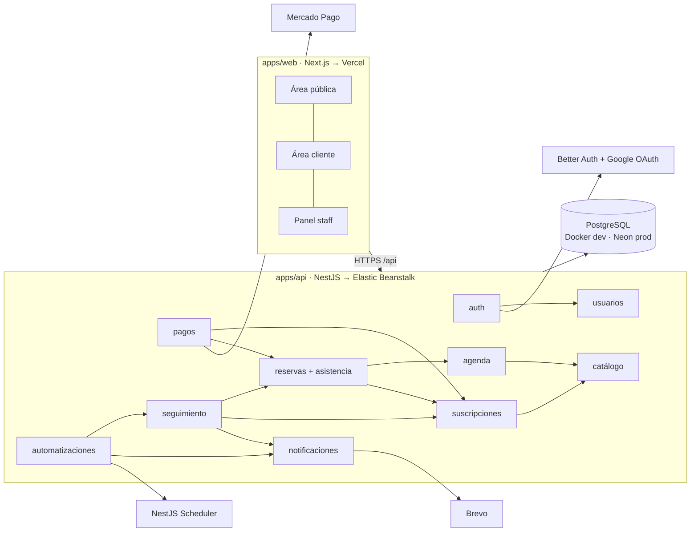

# MOVE: arquitectura

Punto de entrada para cualquiera que trabaje en MOVE. La fuente de cada afirmación es
`MOVE.pdf`, los mockups de `imagenes/` o el código de `apps/`. La de cada decisión es
su nota en `decisions/`. Este documento solo las conecta. Para la mecánica del vault,
ver [[00-START-HERE]].

## Qué es MOVE

MOVE es un centro de Performance (entrenamiento semi personalizado), Rehab
(fisioterapia) y Recovery (Recovery Room) en Uruguay. Reconstruye su web para pasar
de un sitio informativo con reservas a un sistema que conecta todo el ciclo del
cliente: registro → plan → pago → reserva → asistencia → seguimiento → renovación o
reactivación ([[Circuito principal MOVE]]). Hay tres perfiles: visitante, cliente y
staff ([[ADR tres perfiles de usuario]]). El MVP dura 4 semanas, del 12/10/2026 al
06/11/2026, con dos Full Stack ([[ADR alcance MVP en cuatro semanas]]).

**Regla que gobierna todo:** la lógica de negocio (vigencias, cupos, confirmaciones,
alertas) vive en la API de MOVE sobre PostgreSQL. Los proveedores (Mercado Pago,
Brevo, Better Auth, Google) quedan encapsulados en un service por proveedor.

## Mapa del sistema

- [[Monorepo MOVE]]: pnpm workspaces, el contenedor de todo. Ya construido.
- [[App web Next]]: una sola app con [[Area publica web]], [[Area cliente web]] y [[Panel staff web]]. Hoy es el scaffold.
- [[API NestJS]]: módulos simples por dominio en `src/modules/` (controller → service → repositorio). Hoy tiene la base (config, DB, validación, CORS) y ningún módulo de dominio.
- Módulos: [[Modulo usuarios]], [[Modulo auth]], [[Modulo catalogo]], [[Modulo agenda]], [[Modulo suscripciones]], [[Modulo reservas]], [[Modulo pagos]], [[Modulo seguimiento]], [[Modulo automatizaciones]], [[Modulo notificaciones]].
- Datos: [[Postgres local Docker]] en desarrollo, [[Neon Postgres]] en producción.
- Externos: [[Better Auth]], [[Google OAuth]], [[Mercado Pago]], [[Brevo]], [[NestJS Scheduler]], [[Vercel]], [[AWS Elastic Beanstalk]].

## Vocabulario

| Término | Significado exacto en este proyecto |
| --- | --- |
| Plan | Producto del catálogo con precio y período ([[Plan]]). No es lo que tiene el cliente. |
| Suscripción | Plan contratado por un cliente, con inicio y vencimiento ([[Suscripcion]]). "Plan vigente" = suscripción no vencida. |
| Compra / Pago | Intención de pagar algo / operación de Mercado Pago con estado ([[Compra]], [[Pago]]). |
| Horario / turno | Franja de agenda con cupo ([[Horario]]). En Rehab es la franja de un profesional ([[Disponibilidad profesional]]). |
| Cupo | Capacidad máxima de un horario ([[Cupo maximo por horario]]). |
| Reserva | Lugar tomado en un horario ([[Reserva]]). **No** implica asistencia. |
| Asistencia | Resultado cargado por el staff: presente, ausente o no show ([[Asistencia]], [[Estados de asistencia]]). |
| Evaluación | Evaluación y Diagnóstico, puerta de entrada a Rehab y lo único de Rehab que se compra directo en la web ([[Evaluacion y diagnostico]]). Después puede seguir un [[Seguimiento fisioterapeutico]]. |
| Paquete | Plan Recovery mensual de N sesiones ([[Paquete de sesiones Recovery]]). |
| Alerta | Situación detectada que pide acción del staff ([[Alerta de seguimiento]]). |
| Motivo | Razón registrada de una inactividad ([[Motivo de inactividad]]). |
| Check-in | Encuesta breve a alumnos activos ([[Check-in]]). |
| Estado del cliente | Activo, por vencer, vencido, inactivo o en pausa. Es derivado, no se carga ([[Estado del cliente]]). |

## Las decisiones, conectadas

**Plataforma, ya aplicada.** [[ADR monorepo pnpm sin Turborepo]] ·
[[ADR NestJS 12 en ESM]] → [[Imports relativos con extension js]] ·
[[ADR TypeORM con migraciones por CLI]] → [[Esquema solo via migraciones]] →
previene [[Drift de esquema entre ambientes]] ·
[[ADR Next App Router en lugar de Vite]] → [[Paginas publicas renderizadas en servidor]] ·
[[ADR shadcn base-nova sobre Base UI]] → [[Estilos via tokens del tema]].
Acordada, se aplica con el primer módulo: [[ADR modulos simples por dominio]]
(reemplaza a [[ADR arquitectura hexagonal por modulo]]) → [[Entidades ORM no salen del servicio]],
[[Integraciones externas encapsuladas en un servicio]] y [[Dependencias entre modulos aciclicas]].

**Identidad.** [[ADR tres perfiles de usuario]] → [[Roles persistidos cliente y staff]]
y [[Cuenta se crea durante la reserva]]. [[ADR Better Auth con Google OAuth]] →
[[Autorizacion validada en la API]] (previene [[Cliente accede a funciones de staff]])
y [[Una cuenta por email]] (previene [[Cuentas duplicadas por email]]).
[[ADR ubicacion de Better Auth]] está **abierta** → [[Web y API bajo el mismo dominio raiz]]
(previene [[Sesion no viaja entre web y API]]).

**Agenda y reservas.** [[ADR calendario propio]] → [[Cupo maximo por horario]] y
[[Reserva con bloqueo transaccional]] (previenen [[Sobreventa de cupos]]), y
[[Configuracion operativa administrada por staff]].

**Pagos.** [[ADR Mercado Pago como procesador de pagos]] →
[[Pago confirmado solo por webhook validado]] (previene [[Webhook falsificado]] →
[[Plan activado sin pago confirmado]]), [[Operaciones de pago idempotentes]] (previene
[[Webhook duplicado procesado dos veces]] → [[Vigencia extendida dos veces]]),
[[Activacion en la misma transaccion que el pago]] (previene
[[Pago aprobado sin activar plan]]) y [[Logica de negocio fuera de Mercado Pago]].

**Seguimiento.** [[ADR automatizaciones con NestJS Scheduler]] →
[[Reglas de automatizacion en Postgres]], [[Jobs programados idempotentes]] y
[[Scheduler corre en una sola instancia]]. Esta última previene
[[Job ejecutado en varias instancias]], que habilita
[[ADR Elastic Beanstalk para la API]] y que causa [[Alertas o emails duplicados]].

**Alcance.** [[ADR alcance MVP en cuatro semanas]] → [[IA y planificaciones fuera del MVP]],
[[Demo semanal de flujo visible]] y [[Accesos y definiciones operativas al inicio]].

## Lo diseñado que todavía no existe

Al 2026-10-13, en el repo solo existen el monorepo, el scaffold web, la base de la API
y Postgres en Docker. **Todo módulo, pantalla y regla de negocio está en `todo`.**

Propuesto por el vault, no por MOVE (`proposed`, confirmar antes de implementar):
- [[Reservas concurrentes al ultimo cupo]] (mecanismo), [[Reserva con bloqueo transaccional]], [[Cancelacion libera el cupo]] y [[Asistencia pendiente visible para staff]]
- [[Reserva pendiente de pago expira]] y [[Sesiones Recovery no exceden el paquete]]
- [[Operaciones de pago idempotentes]], [[Activacion en la misma transaccion que el pago]], [[Conciliacion periodica de pagos pendientes]] y [[Renovacion extiende desde el vencimiento]]
- [[Jobs programados idempotentes]], [[Scheduler corre en una sola instancia]] y [[Clientes en pausa excluidos de alertas]]
- [[Una cuenta por email]] y [[Web y API bajo el mismo dominio raiz]]
- [[ADR zona horaria de negocio]] / [[Fechas en zona horaria de Uruguay]] y [[Paridad de version Postgres dev y prod]]
- [[ADR capa de datos del frontend]], [[Formularios validados con Zod]], [[Estilos via tokens del tema]] y [[Pantalla checkout de pago]]

Apagado por configuración: [[Conexion SSL a la base en produccion]].

Abierto (`draft`, bloquea; preguntar a MOVE o al equipo):
- [[ADR ubicacion de Better Auth]]: ¿Next o Nest? Define dominios y cookies.
- [[Accesos y definiciones operativas al inicio]]: accesos a proveedores, planes, horarios, cupos y límite de cancelación.
- [[Estados de asistencia]]: ¿ausente vs no show?
- [[Umbrales de seguimiento]]: inactividad prolongada y baja de frecuencia.
- [[Pantalla dashboard staff]], [[Pantalla pagos staff]] (¿pagos manuales?) y [[Pantalla configuracion staff]]: no tienen mockup.
- [[Seguimiento fisioterapeutico]]: cómo se habilita, paga y agenda.
- [[Sesiones Recovery no usadas]] y [[Prioridad de horarios Recovery]]: reglas del paquete.
- [[Envio de check-ins]]: manual, programado o ambos; canal.
- [[Alta manual de clientes]]: botón "Nuevo cliente" sin flujo definido.

## Para profundizar

Las espinas: [[MOC Circuito Performance]], [[MOC Pagos y activacion]],
[[MOC Seguimiento y retencion]] y [[MOC Identidad y acceso]]. Además
[[MOC Rehab y Recovery]], [[MOC Plataforma y entrega]] y [[MOC Pantallas]]. El plan de
construcción está en [[MOC Roadmap MVP]].

Disciplina de cambio: una decisión nunca se edita para decir lo contrario. Se crea un
ADR nuevo que la `supersedes` y la vieja pasa a `status: superseded`.
