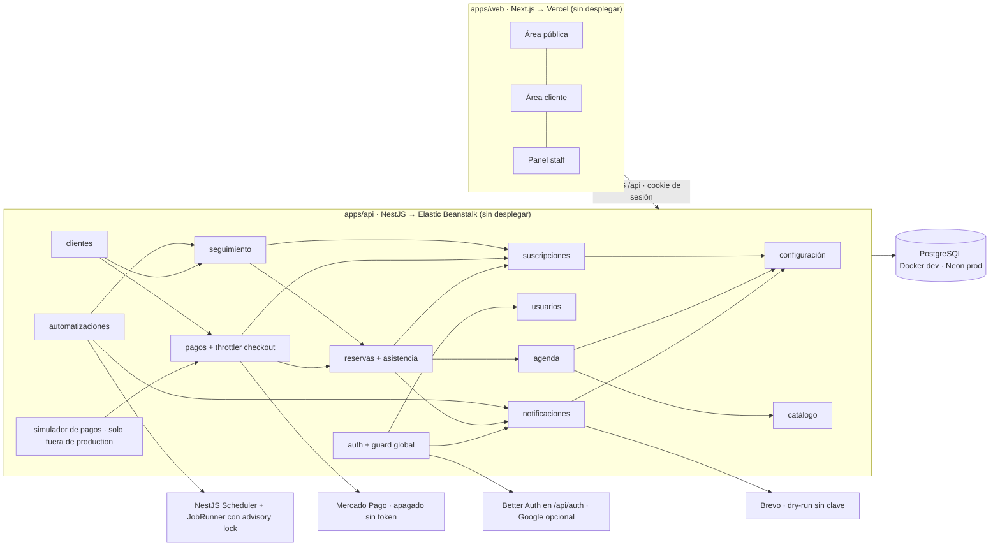

# MOVE: arquitectura

Punto de entrada para cualquiera que trabaje en MOVE. La fuente de cada afirmación es
`MOVE.pdf`, los mockups de `imagenes/`, el plan en `docs/superpowers/plans/` o el código
de `apps/`. La de cada decisión es su nota en `decisions/`. Este documento solo las
conecta. Para la mecánica del vault, ver [[00-START-HERE]].

## Qué es MOVE

MOVE es un centro de Performance (entrenamiento semi personalizado), Rehab
(fisioterapia) y Recovery (Recovery Room) en Uruguay. Reconstruye su web para pasar
de un sitio informativo con reservas a un sistema que conecta todo el ciclo del
cliente: registro → plan → pago → reserva → asistencia → seguimiento → renovación o
reactivación ([[Circuito principal MOVE]]). Hay tres perfiles: visitante, cliente y
staff ([[ADR tres perfiles de usuario]]). El MVP dura 4 semanas, del 12/10/2026 al
06/11/2026, con dos Full Stack ([[ADR alcance MVP en cuatro semanas]]).

**Regla que gobierna todo:** la lógica de negocio (vigencias, cupos, confirmaciones,
alertas) vive en la API de MOVE sobre PostgreSQL. Los proveedores (Mercado Pago,
Brevo, Better Auth, Google) quedan encapsulados en un service por proveedor.

## Mapa del sistema

- [[Monorepo MOVE]]: pnpm workspaces, con [[Pipeline CI Bitbucket]] y los scripts del [[Manual de usuario]].
- [[App web Next]]: una sola app con [[Area publica web]], [[Area cliente web]] y [[Panel staff web]]; `proxy.ts` reenvía la ruta para volver a ella al ingresar.
- [[API NestJS]]: doce módulos simples por dominio en `src/modules/`, en un orden de dependencias fijo. `app.setup.ts` arma `trust proxy` ([[IP real del cliente detras del proxy]]), CORS, Better Auth, validación y el filtro de errores.
- Módulos: [[Modulo configuracion]], [[Modulo notificaciones]], [[Modulo usuarios]], [[Modulo auth]], [[Modulo catalogo]], [[Modulo agenda]], [[Modulo suscripciones]], [[Modulo reservas]], [[Modulo pagos]] (con el [[Simulador de pagos de desarrollo]]), [[Modulo seguimiento]], [[Modulo clientes]], [[Modulo automatizaciones]].
- Datos: [[Postgres local Docker]] en desarrollo, [[Neon Postgres]] en producción (sin configurar).
- Externos: [[Better Auth]], [[Google OAuth]], [[Mercado Pago]], [[Brevo]], [[NestJS Scheduler]], [[Vercel]], [[AWS Elastic Beanstalk]].

- Pruebas de navegador: [[Suite E2E Playwright]] (desktop y mobile, base `move_e2e` propia, puertos 3150/3250; no corre en el pipeline).

## Vocabulario

| Término | Significado exacto en este proyecto |
| --- | --- |
| Plan | Producto del catálogo con precio y período o sesiones ([[Plan]]). No es lo que tiene el cliente. |
| Suscripción | Plan contratado por un cliente, con inicio y fin ([[Suscripcion]]). "Plan vigente" = suscripción no vencida a la fecha del turno. |
| Compra / Pago | Intención de pagar algo / operación con estado, de Mercado Pago o manual ([[Compra]], [[Pago]]). |
| Retención | Reserva paga en `pending_payment` que vence si no llega el pago ([[Reserva pendiente de pago expira]]). |
| Horario / turno | Fila de `time_slots` con cupo ([[Horario]]). En Rehab es el turno de un profesional ([[Disponibilidad profesional]]). |
| Cupo | Capacidad máxima de un turno ([[Cupo maximo por horario]]). |
| Reserva | Lugar tomado en un turno ([[Reserva]]). **No** implica asistencia. |
| Asistencia | Presente, ausente o no show, cargado por el staff ([[Asistencia]], [[Estados de asistencia]]). |
| Evaluación | Evaluación y Diagnóstico, lo único de Rehab que se compra en la web ([[Evaluacion y diagnostico]]). Después puede seguir un [[Seguimiento fisioterapeutico]] habilitado por el staff. |
| Paquete | Plan Recovery de N sesiones por 30 días ([[Paquete de sesiones Recovery]]). |
| Alerta | Situación detectada que pide acción del staff ([[Alerta de seguimiento]]). |
| Pausa / motivo | Razón registrada de una inactividad ([[Motivo de inactividad]]). |
| Check-in | Encuesta breve a alumnos activos ([[Check-in]]). |
| Estado del cliente | Activo, por vencer, vencido, inactivo o en pausa. Es derivado ([[Estado del cliente]]). |
| Needs attention | Compra aprobada que el staff resuelve a mano ([[ADR pago tardio sin lugar queda para el staff]]). |

## Las decisiones, conectadas

**Plataforma.** [[ADR monorepo pnpm sin Turborepo]] · [[ADR NestJS 12 en ESM]] →
[[Imports relativos con extension js]] · [[ADR TypeORM con migraciones por CLI]] →
[[Esquema solo via migraciones]] · [[ADR Next App Router en lugar de Vite]] →
[[Paginas publicas renderizadas en servidor]] · [[ADR shadcn base-nova sobre Base UI]] →
[[Estilos via tokens del tema]] · [[ADR capa de datos del frontend]] ·
[[ADR modulos simples por dominio]] → [[Entidades ORM no salen del servicio]],
[[Integraciones externas encapsuladas en un servicio]] y [[Dependencias entre modulos aciclicas]].
Configuración y errores: [[ADR errores 4xx fuera de contrato como validacion]],
[[ADR un parser por variable de entorno]] → [[Variable de entorno parseada una sola vez]],
[[ADR errores de campo con copy propio]] → [[Mensajes de validacion de la API no llegan al usuario]].
Mobile: [[ADR menu movil en las tres areas]] → [[Pantallas sin scroll horizontal en mobile]].

**Desarrollo sin accesos.** [[ADR desarrollo sin accesos a proveedores]] y
[[ADR simulador registrado con ConditionalModule]] → [[Simulador de pagos solo fuera de produccion]],
que previene [[Simulador de pagos montado en produccion]] (la falla que había causado
[[Config leida al importar antes de cargar el entorno]]). [[ADR sin deploy en el run del MVP]]
deja Vercel, Elastic Beanstalk y Neon en `todo`.

**Identidad.** [[ADR Better Auth con Google OAuth]] y [[ADR ubicacion de Better Auth]]
(en Nest) → [[Autorizacion validada en la API]], [[Una cuenta por email]] y
[[Web y API bajo el mismo dominio raiz]]. [[ADR Better Auth endurecido]],
[[ADR volver a la pagina exacta tras ingresar]], [[ADR create-staff exige promote-existing]] y
[[ADR invitacion de 72 horas]].

**Agenda y reservas.** [[ADR calendario propio]] → [[Cupo maximo por horario]] y
[[Reserva con bloqueo transaccional]] (previenen [[Sobreventa de cupos]]).
[[ADR limite de retenciones y de checkout por IP]] y
[[ADR IP real detras del proxy y ventana horaria]] → [[Retenciones de pago limitadas por usuario]],
[[Checkout publico limitado por IP]] e [[IP real del cliente detras del proxy]] (contra
[[Retenciones masivas de invitados]] y [[Throttling por IP ve la IP del proxy]]).
Catálogo: [[ADR slug de plan reutilizable tras borrado]].

**Pagos.** [[ADR Mercado Pago como procesador de pagos]] →
[[Pago confirmado solo por webhook validado]], [[Operaciones de pago idempotentes]]
(requiere [[Queries crudas con RETURNING via CTE]]), [[Activacion en la misma transaccion que el pago]]
y [[Conciliacion periodica de pagos pendientes]]. Pagos tardíos: [[ADR pago tardio sin lugar queda para el staff]],
[[ADR retencion vencida sin lugar no se reconfirma]] y [[ADR conciliacion de reservas vencidas por 72 horas]]
(reemplaza a [[ADR conciliacion re-consulta compras vencidas]]).
Planes rechazados: [[ADR pago de plan rechazado deja la compra pendiente]] →
[[ADR reintento visible para plan rechazado]].

**Seguimiento.** [[ADR automatizaciones con NestJS Scheduler]] →
[[Reglas de automatizacion en Postgres]], [[Jobs programados idempotentes]] y
[[Scheduler corre en una sola instancia]] (advisory lock). [[ADR renovacion programada no cuenta como por vencer]].

**Alcance y entrega.** [[ADR alcance MVP en cuatro semanas]] · [[ADR suite E2E desktop y mobile]]
(reemplaza a [[ADR sin E2E web de demos]]) → [[Suite E2E solo sobre su base propia]] ·
[[ADR sin archivos env nuevos]] · [[ADR manual de usuario con capturas]] ·
[[ADR manual con guia de proveedores]] · [[ADR push a GitHub y merge por PR]].

## Lo que todavía no existe

Al 2026-10-13 (`feature/move-mvp`, commit be89bc5) el MVP completo corre en local y
está cubierto por tests unitarios y e2e de la API y tests de componentes de la web. El
[[Manual de usuario]] documenta el estado frente al PDF, cómo levantar todo y la guía
por proveedor. Falta:

- Deploy (`todo`): [[Vercel]], [[AWS Elastic Beanstalk]], [[Neon Postgres]], [[Ambientes dev y produccion separados]], [[Web y API bajo el mismo dominio raiz]].
- Apagado hasta tener credenciales o configuración (`built-off-by-default`): [[Google OAuth]], [[Mercado Pago]], [[Brevo]], [[Conexion SSL a la base en produccion]], [[IP real del cliente detras del proxy]].
- Documentado en el runbook y el manual, sin aplicar (`proposed`): [[PORT explicito en Elastic Beanstalk]], [[Rama dev de Neon sin expiracion]], [[Ambiente dev en dominio registrable propio]], [[Paridad de version Postgres dev y prod]].
- CI configurado pero nunca ejecutado: [[Pipeline CI Bitbucket]].
- Deuda conocida (`todo`): [[Variable de entorno parseada una sola vez]] para `PORT`, `DB_PORT` y `DB_SSL`; [[Build de Next falla con NODE_ENV development]] sin defensa en scripts.

Abierto (`draft`, preguntar al usuario o a MOVE):
- [[ADR notificaciones de Mercado Pago por ambiente]] (D68): IPN sin firma o URL del panel por ambiente.
- [[Bloqueo de IPs de Brevo resuelto antes de produccion]].
- [[Prioridad de horarios Recovery]]: quitada de los textos hasta que MOVE la defina.
- [[ADR push a GitHub y merge por PR]] está aprobada pero sin remoto, y deja abierto dónde corre [[Pipeline CI Bitbucket]].
- Dominio final y dominio registrable de desarrollo; valores provisorios a confirmar con MOVE: [[Accesos y definiciones operativas al inicio]], [[Umbrales de seguimiento]], precios y horarios de la semilla.

## Para profundizar

Las espinas: [[MOC Circuito Performance]], [[MOC Pagos y activacion]],
[[MOC Seguimiento y retencion]] y [[MOC Identidad y acceso]]. Además
[[MOC Rehab y Recovery]], [[MOC Plataforma y entrega]] y [[MOC Pantallas]]. El estado
de construcción está en [[MOC Roadmap MVP]].

Disciplina de cambio: una decisión nunca se edita para decir lo contrario. Se crea un
ADR nuevo que la `supersedes` y la vieja pasa a `status: superseded`.
